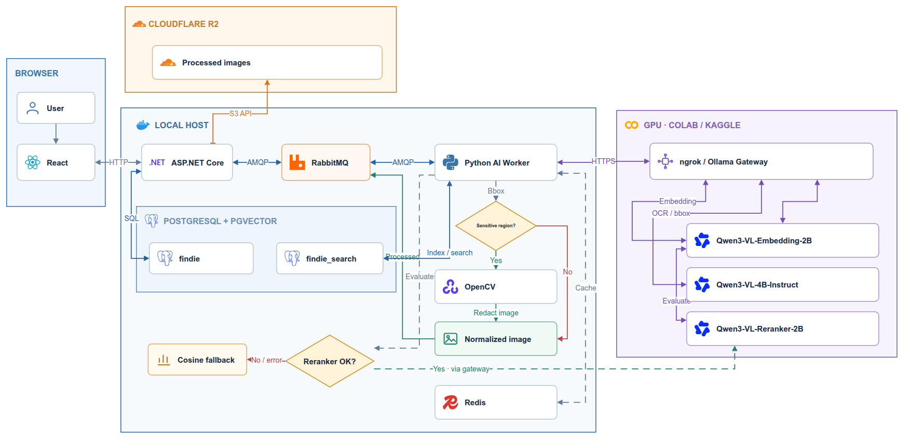
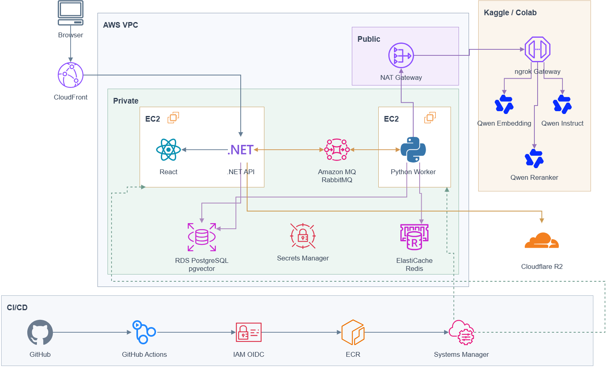

# Findie

Findie helps people find and return lost belongings. Finders publish privacy-reviewed item photos, owners search by description or image, and both sides verify ownership before arranging a return. Reception points (Hubs) support physical intake, custody tracking and verified handovers.

Built with **React 19, TypeScript, ASP.NET Core 10, Python/FastAPI, PostgreSQL 17 + pgvector, RabbitMQ and Redis**. Multimodal inference runs on a separate GPU host; processed images stay in a private Cloudflare R2 bucket.

## Architecture

### Local development and AI processing



[Editable draw.io source](docs/architecture/system-overview.drawio), adapted from the supplied architecture diagram with English labels.

| Component | Responsibility | Default local address |
| --- | --- | --- |
| React + Vite | User, Hub and administrator interfaces; proxies `/api` to .NET | [127.0.0.1:5173](http://127.0.0.1:5173) |
| ASP.NET Core API | Google authentication, authorization, item/recovery workflows, image access and R2 storage | `127.0.0.1:5080` |
| Python AI service | FastAPI endpoints, RabbitMQ worker, image redaction, indexing and search | `127.0.0.1:8000` |
| PostgreSQL + pgvector | Separate business (`findie`) and search (`findie_search`) databases and runtime roles | `127.0.0.1:5432` |
| RabbitMQ | Jobs, results and public search-material requests between the API and worker | AMQP `5672`; [management `15672`](http://127.0.0.1:15672) |
| Redis | Short-lived search-candidate and account-scoped embedding caches | `127.0.0.1:6379` |
| GPU inference gateway | Qwen embedding, vision grounding/OCR and optional reranking over authenticated HTTPS | Colab, Kaggle or a GPU host you control |
| Cloudflare R2 | Private storage for processed images; accessed through the API | Your S3-compatible endpoint |

Docker Compose runs **PostgreSQL, RabbitMQ and Redis**. `make local-run` starts the web application, API and AI worker on your machine. The GPU models run separately, so a local GPU or Ollama installation is unnecessary when using notebook 04.

The API owns business data and access control. RabbitMQ connects it to the worker, which normalizes images, asks the vision model for sensitive regions and applies redaction with OpenCV. Only processed output is stored in R2; users review and approve the current output before publication. The worker builds a search projection from public descriptions and approved images, combines vector similarity with keyword/location matches and optionally reranks candidates. If the reranker is unavailable, search uses similarity fallback.

**Privacy:** original uploads remain transient and must never be persisted to disk, R2, broker messages or the search database. Private ownership evidence and personal data must stay out of public search and logs. Model output is validated, and image processing does not replace human review.

### AWS deployment



[Editable draw.io source](docs/architecture/aws-deployment.drawio), extracted from the supplied deployment diagram.

CloudFront reaches the application EC2 instance through a VPC origin. The application serves the built React frontend and .NET API; a separate private EC2 instance runs the worker. Amazon MQ provides RabbitMQ, RDS provides PostgreSQL/pgvector, and ElastiCache provides Redis. NAT supplies outbound connectivity to the GPU gateway. R2 remains private, outside AWS.

GitHub Actions uses IAM OIDC to publish immutable commit-tagged images to ECR and deploy through Systems Manager. Runtime secrets come from Secrets Manager. The deployment template trusts `qbael/Findie2.0` on `main`; repository variables, IAM trust and cloud resources must be configured separately. The current deployment uses single instances and does not provide high availability. See the [AWS deployment runbook](infra/aws/README.md).

## Repository layout

Application code is grouped by feature. Shared infrastructure stays separate, and existing service entrypoints, API routes and database migrations are preserved.

```text
apps/
  web/
    src/
      features/                account, admin, hubs, items, notifications, recovery, search
      shared/                  reusable components, hooks, API utilities and global styles
      assets/                  fonts and static images
      App.tsx                  application composition and routing
    e2e/                       Playwright flows, page objects and fixtures
  api/
    Features/                  Admin, Authentication, Claims, Conversations, Images,
                               Intakes, Items, Notifications, ReceptionPoints,
                               SavedSearches, Search, Users
    Shared/                    cross-feature recovery workflow, contracts and primitives
    Data/                      EF Core context and migrations
    Infrastructure/            AI/broker/storage adapters, seed and maintenance jobs
    Security/                  shared authorization and Identity integration
    tests/                     API smoke and integration checks
services/ai/
  findie_ai/
    search/                    projection/schema, ranking, reranking, caches and materials
    privacy/                   image validation, normalization and redaction
    inference/                 model gateway client
    main.py                    FastAPI entrypoint
    worker.py                  broker orchestration
    migrate.py                 search schema entrypoint
    evaluate.py                offline search evaluation entrypoint
  tests/                       AI unit and integration checks
infra/aws/                     infrastructure template and release tooling
scripts/                       local setup, run, doctor, model import and maintenance
notebooks/colab/                GPU experiments and full-stack gateway notebook
tests/                        bootstrap, gateway, notebook and deployment checks
docs/                          architecture, API, data, product and development references
compose.yaml                   local PostgreSQL, RabbitMQ and Redis
Makefile                       setup, development and test commands
Findie.sln                     .NET solution
```

See the [feature organization guide](docs/guides/feature-organization.md) for where to add or find code.

## Run locally

Run all commands from the repository root. On Windows, use WSL2 with Docker integration and install the command-line tools inside the same WSL environment.

### 1. Prerequisites

| Tool or account | Requirement |
| --- | --- |
| Git | Clone the repository |
| Docker + Compose | Running daemon; support for `docker compose up --wait` |
| Node.js + npm | **Node.js 24.x**, matching `.nvmrc` and the web package |
| .NET SDK | **10.0**, at least `10.0.100`; see `global.json` |
| Python + uv | **Python 3.12** and `python3` on PATH; uv manages AI dependencies |
| Make + curl | Available on PATH |
| Google Cloud | OAuth Web client; two Google accounts to exercise both sides of a return |
| Cloudflare | Private R2 bucket and bucket-scoped S3 credentials |
| GPU host + ngrok | An active compatible GPU session and your own ngrok account/token |

If necessary, install Python with `uv python install 3.12`. Initial setup downloads packages, container images and models. Keep the GPU session and HTTPS gateway running while using AI features; use a GPU provider that permits your intended workload.

### 2. Clone and generate local configuration

```sh
git clone https://github.com/qbael/Findie2.0.git
cd Findie2.0

# If using nvm:
nvm install
nvm use

make env
```

`make env` generates local database/broker passwords and the internal service token, then creates RabbitMQ definitions. Running it again preserves existing values and fills missing settings. `.env.example` documents the public configuration structure; its placeholders are not runnable credentials.

Keep `.env` local and out of Git. Use only environment files you control, because the development scripts load them as trusted shell configuration. Do not put backend credentials in `VITE_*` variables, notebooks or source control.

### 3. Configure Google OAuth and private R2 storage

Create a Google OAuth client of type **Web application** and register this exact redirect URI:

```text
http://127.0.0.1:5173/api/auth/google/signin
```

Configure the consent screen and any required test users. Set `Authentication__Google__ClientId` and `Authentication__Google__ClientSecret` in your local configuration. Use `127.0.0.1:5173` consistently: the callback goes through Vite, rather than directly to API port 5080.

Create a private R2 bucket, disable public access and create **Object Read & Write** credentials scoped to that bucket. Set these backend variables:

```dotenv
Storage__Endpoint='https://YOUR_ACCOUNT_ID.r2.cloudflarestorage.com'
Storage__Bucket='findie-local'
Storage__AccessKeyId='YOUR_ACCESS_KEY_ID'
Storage__SecretAccessKey='YOUR_SECRET_ACCESS_KEY'
```

Use the endpoint appropriate to your bucket jurisdiction. Browsers receive images through the API; a public bucket is unnecessary. Complete both OAuth and storage configuration before starting the full application.

### 4. Install dependencies and initialize infrastructure

```sh
docker info
make local-setup
docker compose ps
```

This installs locked dependencies, restores .NET tools, starts all three infrastructure containers, synchronizes broker accounts/permissions/queues, applies business migrations, provisions the separate search database and runtime role, and migrates the search schema. It also creates **Findie Demo Hub**, without creating fake users or assigning staff.

Wait for `Local infrastructure ready`. This step does not start the application or download GPU models. Re-running preserves existing data and credentials. Migration guards may stop on legacy databases rather than risk data loss; do not import the historical SQL diagrams in place of EF migrations.

### 5. Start the GPU models and HTTPS gateway

Open [04_full_stack_ollama_ngrok.ipynb](notebooks/colab/04_full_stack_ollama_ngrok.ipynb) in Google Colab or another compatible GPU notebook environment. Notebooks 01–03 are individual experiments.

1. Select a GPU runtime and execute the cells in order. Restart the runtime if an installation cell requires it.
2. Supply `NGROK_AUTHTOKEN` and `FINDIE_OLLAMA_TOKEN` through notebook secrets or the hidden prompt. The gateway token must contain at least **32 non-whitespace ASCII characters**. It differs from both the ngrok token and the local `AI_SERVICE_TOKEN`.
3. Wait for embedding, vision, and authenticated gateway checks to pass. The notebook uses `Qwen/Qwen3-VL-Embedding-2B` for native 2048-dimensional text/image embeddings and `qwen3-vl:4b-instruct` for sensitive-region detection. The optional `Qwen/Qwen3-VL-Reranker-2B` needs additional VRAM; failure to load it leaves similarity fallback available.
4. Run the notebook's configuration-download cell to save `findie-colab.json`. Keep the GPU session active.

The exported JSON contains public model configuration, not the gateway token. Do not upload Google, R2, database or broker credentials to the notebook. See the [AI guide](docs/guides/ai-service.md) and [Colab guide](docs/guides/colab.md) for detailed model and GPU notes.

### 6. Import model settings and launch

```sh
python3 scripts/configure_ollama.py "$HOME/Downloads/findie-colab.json"
make local-run
```

Enter the same `FINDIE_OLLAMA_TOKEN` used in the notebook when prompted. The importer verifies the gateway and model identity before updating local settings. Use the exported model revisions and profiles: changing only a model name does not enable compatible image search.

`make local-run` checks configuration and port availability, starts infrastructure, synchronizes RabbitMQ, builds the API, and starts the worker, API and Vite in order. It waits for AI capabilities and the web-to-API proxy before printing:

```text
Findie ready: http://127.0.0.1:5173
```

Open [Findie](http://127.0.0.1:5173). Keep this terminal open. For separate development terminals, use `make ai`, `make api`, and `make web` after configuration; run only one worker and choose either those commands or `make local-run`.

### 7. Sign in, assign Hub staff and check readiness

Sign in with Google at [the sign-in page](http://127.0.0.1:5173/signin). In another terminal at the repository root:

```sh
make local-seed STAFF_EMAIL='your-google-email@gmail.com'
make local-doctor

curl -i http://127.0.0.1:5080/health/live
curl -i http://127.0.0.1:5080/health/ready
curl -i http://127.0.0.1:8000/health/live
curl -sS http://127.0.0.1:5173/api/system/status
```

Staff assignment requires an existing Google-authenticated user and only runs in Development. It grants access to the Demo Hub; administrator access is configured separately through `ADMIN_EMAILS`.

The doctor should report all checks as **PASS**. Health endpoints above should return HTTP 200; system status should show `database: "ready"`, `ai: "ready"`, and authentication/storage enabled. System status can return HTTP 200 during dependency failure, so inspect its JSON. The AI service's readiness/status endpoints require the internal service token; liveness alone does not verify inference.

### 8. Exercise the main workflows

Use non-sensitive demo images first.

1. **Publish:** create a found-item post with 1–3 JPEG/PNG/WebP images, up to 10 MiB each. Wait for processing, review the processed output, confirm the image-review checks and approve before publication.
2. **Search:** find the published item by description and image; try location and other filters. Allow indexing to complete before expecting results.
3. **Recover:** sign in with a second Google account in another browser profile, submit a claim, approve it as the finder, exchange messages and confirm the handover after verifying ownership.
4. **Hub intake and return:** create another item destined for the Demo Hub, acknowledge physical receipt as assigned staff, then complete a verified return and inspect custody history.

Only processed output should reach R2. Removing or rejecting the last approved public image hides a published post. A fresh database has no sample accounts or item listings.

## Daily development

- **Stop:** press Ctrl+C in the application terminal, then run `make local-stop`. Database volumes remain intact. End the GPU session separately when finished.
- **Restart:** resume the GPU gateway, import a new JSON if its address changed, then run `make local-run` and `make local-doctor`.
- **After dependency/schema changes:** run `make local-setup` before restarting.
- **After model changes:** import the new configuration, restart, then run `make local-reindex` once the worker is ready. Reindexing uses stored processed output.
- **Infrastructure logs:** `docker compose logs --tail=100 db rabbitmq redis`.

Do not use `docker compose down -v` if you need to retain local data.

| Symptom | Check |
| --- | --- |
| OAuth redirect mismatch | Exact host, port and `/api/auth/google/signin` URI; consent/test-user settings |
| AI unavailable or revision mismatch | Active GPU runtime/tunnel, matching gateway token and a fresh notebook JSON import |
| Images remain pending or fail | R2 configuration, worker consumer, model readiness and `make local-doctor` |
| No search results | Publication/image approval, completed indexing and model/index compatibility |
| Port already in use | Stop the existing process before starting the managed local runner |
| Legacy database migration rejected | Use a reviewed migration plan; keep existing data and volumes |

## Tests

Install dependencies first with `make setup` or `make local-setup`.

| Command | Coverage |
| --- | --- |
| `make check` | Root Python checks, AI tests, API build/smoke, web tests and production build |
| `npm test --prefix apps/web` | Web feature and shared utility unit tests |
| `npm run build --prefix apps/web` | TypeScript, lint and Vite production bundle |
| `uv run --project services/ai --locked pytest services/ai/tests` | AI unit tests; live store/cache checks may skip without test services |
| `make api-integration` | Disposable PostgreSQL/RabbitMQ and API integration checks; requires Docker |
| `make ai-integration` | Disposable PostgreSQL/RabbitMQ/Redis and worker checks; requires Docker |
| `npm run test:e2e --prefix apps/web` | Playwright user flows; requires installed Playwright browsers |

Integration harnesses create and remove their own containers. Unit tests and model stubs do not replace a real OAuth, R2 and GPU workflow check.

## Documentation

- [Documentation index](docs/README.md) and [feature organization](docs/guides/feature-organization.md).
- [.NET API](docs/api/README.md), [AMQP contracts](docs/api/amqp.md), and [media/search API](docs/api/media-search.md).
- [AI service](docs/guides/ai-service.md), [Colab](docs/guides/colab.md), and [search evaluation](docs/guides/search-evaluation.md).
- [Detailed system architecture](docs/architecture/system-architecture.md), [database design](docs/database/database-design.md), and [AWS deployment](infra/aws/README.md).
- [Product specification](docs/product/DAC_TA_FINDIE.md) and [UI design references](docs/design/stitch/README.md).

The README and feature guide are in English. Some historical specifications and detailed reference documents remain in Vietnamese.
