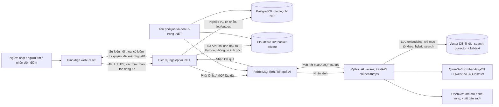
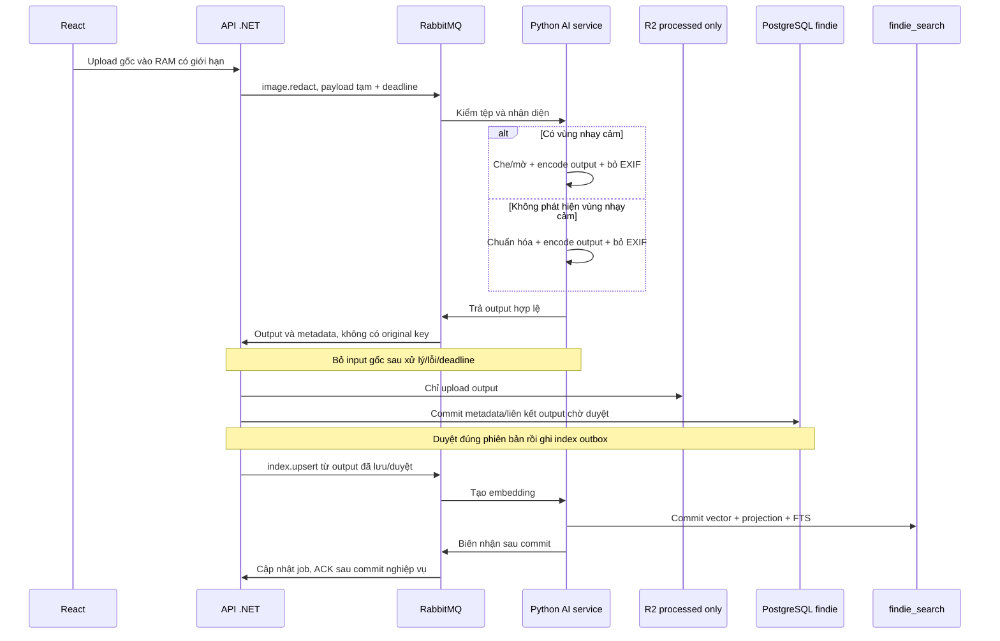
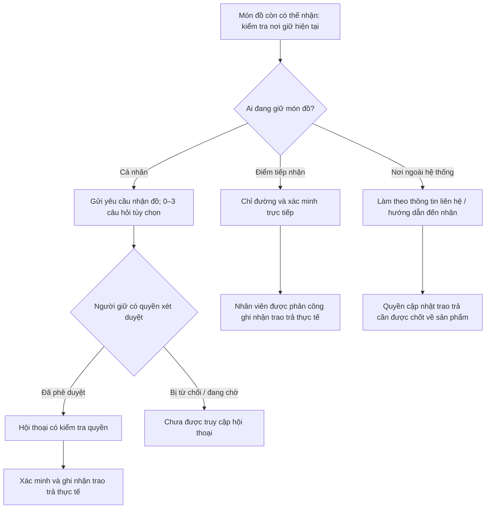

# Kiến trúc hệ thống Findie

**Phiên bản:** 1.4.0 · **Ngày:** 2026-10-23 · **Trạng thái:** Thiết kế đích MVP; Python lưu embedding và thực hiện hybrid search, .NET xử lý nghiệp vụ, giao tiếp RabbitMQ; R2 chỉ lưu ảnh đầu ra, không lưu gốc; chưa triển khai đầy đủ

Cập nhật runtime 31/10/2026: đã có API nghiệp vụ, AMQP/R2/outbox và worker text/ảnh; Python normalize/che ảnh, index full manifest/parts và tìm ảnh native. Notebook 04 dùng `Qwen/Qwen3-VL-Embedding-2B`/2048 qua Transformers và `qwen3-vl:4b-instruct` qua Ollama, sau gateway ngrok có hợp đồng API Ollama. Các model/chiều trong thiết kế bên dưới là baseline ban đầu; cấu hình thực thi hiện tại ở [AI service](../guides/ai-service.md), [spec local](../specs/003-local-full-stack/spec.md) và [hợp đồng AMQP](../api/amqp.md). Model/Google/R2 thật và chất lượng chưa được coi là đã nghiệm thu chỉ từ test stub.
[Hiến chương dự án](../../.specify/memory/constitution.md) xác định các nguyên tắc bắt buộc;
[đặc tả sản phẩm](../product/DAC_TA_FINDIE.md) cung cấp phạm vi,
BR01–BR06 và các tình huống nghiệm thu. Đặc tả phân biệt hành vi đã thể hiện trong demo
với những biện pháp bảo đảm được đề xuất cho MVP; tài liệu này giữ nguyên sự phân biệt đó.

## 1. Phạm vi thiết kế và trạng thái quyết định

MVP hỗ trợ đăng tin, tìm bằng mô tả tiếng Việt hoặc ảnh, ba nhánh nhận lại đồ, yêu cầu nhận đồ,
hội thoại sau phê duyệt, tiếp nhận tại điểm và ghi nhận trao trả. Thanh toán, vận chuyển, thu thập
nội dung từ mạng xã hội, thông báo đẩy, điểm tự đăng ký và trang quản trị đầy đủ nằm ngoài phạm vi.

- **Công nghệ đã chọn:** React, .NET, Python, PostgreSQL, Cloudflare R2, Qwen và OpenCV; bản Instruct là `Qwen/Qwen3-VL-4B-Instruct`. Yêu cầu ngày 23/10/2026 chốt toàn bộ AI/ảnh, lưu embedding vào vector database và tìm kiếm hybrid ở Python; nghiệp vụ ở .NET; giao tiếp hai chiều qua RabbitMQ bằng kết nối AMQP lâu dài. Ảnh gốc chỉ dùng tạm để Python xử lý, không được lưu R2; R2 chỉ nhận ảnh đầu ra đã che/mờ hoặc được xác nhận không có vùng nhạy cảm rồi chuẩn hóa. FastAPI giữ vai trò health/ops nội bộ. Tái dùng PostgreSQL + pgvector làm vector database, với database tìm kiếm riêng do Python quản lý trên cùng máy chủ PostgreSQL. Mô hình embedding, thư viện và cấu hình thuật toán cụ thể bên dưới là phương án đề xuất.
- **Phương án cơ sở được đề xuất:** thiết kế và công nghệ bổ trợ bên dưới để kế hoạch
  triển khai xem xét áp dụng và kiểm chứng. Đây không phải những lựa chọn đã được phê duyệt trước đó.
- **Biện pháp bắt buộc:** bảo vệ dữ liệu riêng tư, kiểm tra quyền thay đổi trạng thái,
  phản ánh nơi giữ thực tế, lưu bền vững dữ liệu nghiệp vụ và xử lý lỗi AI trung thực theo hiến chương.
- **Quyết định còn mở:** chính sách sản phẩm, phiên bản bất biến của mô hình/gói, nhà cung cấp đăng nhập/hạ tầng chạy và mục tiêu chất lượng ở mục 11. Nhà cung cấp lưu ảnh đã chốt là R2.

## 2. Công nghệ và trách nhiệm của các thành phần

Bảng này liệt kê bộ công nghệ dự kiến dùng cho MVP. “Đề xuất” là lựa chọn cụ thể để triển khai và kiểm chứng, chưa phải gói đã cài hay cấu hình đã hoạt động.

| Thành phần | Công nghệ | Trách nhiệm và trạng thái |
| --- | --- | --- |
| Giao diện | React, TypeScript, Vite, HTML/CSS | React đã chọn; phần bổ trợ đề xuất cho web responsive, biểu mẫu có nhãn và dùng bàn phím |
| Giao tiếp trình duyệt | Fetch API, HTTPS/JSON, `@microsoft/signalr` | Gọi API .NET và nhận sự kiện chat; không đưa khóa dịch vụ vào trình duyệt |
| Backend nghiệp vụ | C#, .NET, ASP.NET Core Web API | .NET đã chọn; API, phân quyền, kiểm tra dữ liệu, bài đăng, yêu cầu, tiếp nhận và trao trả |
| Đăng nhập và phiên | Google OAuth + ASP.NET Core Identity + EF Core | Lựa chọn triển khai 24/10/2026: chỉ Google, khóa provider subject, `IdentityUser<Guid>`, phiên cookie HttpOnly/Secure và CSRF; không mở endpoint đăng ký/mật khẩu/token. Xem [API](../api/README.md). |
| Truy cập dữ liệu | Entity Framework Core, Npgsql, migrations | Đề xuất dùng giao dịch PostgreSQL và kiểm soát cập nhật đồng thời |
| Dữ liệu nghiệp vụ | PostgreSQL, SQL; database `findie` | Chỉ .NET truy cập: nghiệp vụ, tin nhắn, job/outbox và tham chiếu ảnh; thời điểm sự kiện dùng `timestamptz` |
| Vector database | PostgreSQL + pgvector; database `findie_search`, psycopg 3 và pgvector-python | Python trực tiếp lưu/đọc `vector(2048)` cùng bản chiếu dữ liệu tìm kiếm công khai; tách credential khỏi database nghiệp vụ, chưa cần máy chủ hay sản phẩm vector DB khác [S1, S4] |
| Hybrid search | Python; pgvector cosine + PostgreSQL full-text search + weighted Reciprocal Rank Fusion (RRF) | Python lấy ứng viên từ vector/từ khóa, hợp nhất thứ hạng và trả mã món đồ; trọng số/mục tiêu theo từng trường hợp ở mục 5.3 [S1–S3] |
| Dịch vụ xử lý AI | Python AI worker, aio-pika, Pydantic; FastAPI/Uvicorn cho health/ops | Nhận lệnh/trả kết quả qua RabbitMQ; embedding, nhận diện/OCR, xử lý ảnh, lưu vector và hybrid search; không cung cấp HTTP inference [M4] |
| Giao tiếp .NET ↔ Python | RabbitMQ, AMQP 0-9-1; RabbitMQ.Client (.NET), aio-pika (Python) | RabbitMQ đã chọn; thư viện đề xuất. Mỗi tiến trình giữ kết nối tới broker và channel publish/consume lâu dài, heartbeat và reconnect; lệnh/kết quả AI đều qua message [M1–M4] |
| Thực thi mô hình | PyTorch, Hugging Face Transformers, Accelerate, qwen-vl-utils | Đề xuất chạy trọng số Qwen trên máy chủ; dùng mã inference chính thức đã rà soát và ghim revision |
| Embedding văn bản và ảnh | `Qwen/Qwen3-VL-Embedding-2B` | Đề xuất một mô hình chung, đầu ra 2048 chiều cho hai chế độ tìm kiếm [Q1] |
| Gợi ý vùng nhạy cảm | `Qwen/Qwen3-VL-4B-Instruct` | Chọn bản Instruct 4B theo yêu cầu ngày 22/10/2026; dùng OCR/định vị để trả vùng nghi nhạy cảm, không tự kết luận ảnh đã an toàn [Q2] |
| Xử lý ảnh | OpenCV (`opencv-python-headless`), NumPy, Pillow trong Python | Kiểm MIME thực, giải mã an toàn, giới hạn pixel, chuẩn hóa hướng/resize, che/mờ, bỏ EXIF/GPS và mã hóa bản sạch [O1] |
| Lưu ảnh | Cloudflare R2 | R2 đã chọn; .NET chỉ tải/lấy/xóa ảnh đầu ra Python trong bucket riêng tư, không upload ảnh gốc kể cả tạm thời [R1] |
| Điều phối tác vụ nền | ASP.NET Core `BackgroundService`, RabbitMQ.Client, PostgreSQL | .NET lưu job/outbox, phát lệnh AI/chỉ mục, nhận biên nhận và điều khiển retry/lease; Python commit vector/chỉ mục trước khi báo thành công; .NET lưu trạng thái nghiệp vụ và dọn R2 |
| Chat | ASP.NET Core SignalR | Đề xuất kiểm tra quyền, lưu PostgreSQL trước khi phát sự kiện |
| Chỉ đường | Liên kết bản đồ thông thường | Đề xuất mở địa chỉ điểm tiếp nhận; chưa cần Maps SDK hoặc dịch vụ định tuyến |
| Đóng gói và vận hành | Git, Docker, Docker Compose, HTTPS, AMQPS | Đề xuất mạng nội bộ, volume PostgreSQL/RabbitMQ, ACL broker; health checks tách tiến trình, kết nối broker và model; chọn máy chạy và GPU sau đo |
| Kiểm thử | xUnit + ASP.NET Core integration testing, pytest, Playwright | Đề xuất kiểm thử phân quyền/giao dịch, xử lý ảnh/mô hình và hành trình web; PostgreSQL thật với pgvector trong kiểm thử tích hợp |
| Thiết kế dữ liệu | SQL và diagrams.net (draw.io) | Lược đồ DDL và ERD chỉnh sửa được, xem mục 3 |

Mã mô hình đã có trên kho chính thức; cả hai model card ghi giấy phép Apache-2.0 [Q1, Q2]. Phải ghim commit của trọng số, mã inference, processor, prompt và phiên bản gói tương thích trước chạy thật. Chưa đo chất lượng tiếng Việt, độ bao phủ vùng nhạy cảm, độ trễ hoặc VRAM trên dữ liệu Findie. Hai mô hình dùng chung dịch vụ Python AI worker, không tự phát sinh hai dịch vụ độc lập. Chưa cần Redis, Kafka, Elasticsearch, nhà cung cấp vector DB khác, reranker hoặc dịch vụ model serving bổ sung.

Chỉ .NET quản lý dữ liệu và chính sách nghiệp vụ. Python không có điểm truy cập công khai
cho trình duyệt, thông tin đăng nhập cơ sở dữ liệu nghiệp vụ hoặc quyền duyệt yêu cầu,
mở hội thoại hay ghi nhận bàn giao. React chỉ nhận các trường mà người xem hiện tại được phép truy cập.
Thông tin bí mật được giữ ở phía máy chủ. Ảnh gốc chỉ tồn tại tạm ở bộ nhớ .NET/Python trong request có deadline; không spool ra đĩa ứng dụng, R2, DB, job/outbox, log, backup hoặc body DLQ. Python kiểm tệp, nhận diện và tạo ảnh đầu ra rồi bỏ input cả khi thành công/lỗi/hết hạn; không tạo embedding công khai từ input gốc. .NET kiểm tra quyền, dung lượng byte, hợp đồng message và điều kiện hiển thị cuối cùng; Python kiểm nội dung thực, xử lý ảnh, tạo/lưu embedding và tìm kiếm hybrid. Python chỉ có credential `findie_search`, không có credential database nghiệp vụ `findie` hoặc R2, không tự tải URL tùy ý. .NET không nạp mô hình, xử lý pixel, ghi vector hoặc chạy xếp hạng hybrid. Baseline dùng chung một PostgreSQL instance cho hai database; quyền sở hữu và credential vẫn tách biệt.

### 2.1. RabbitMQ và kết nối lâu dài

- Mỗi bản chạy .NET và Python mở một kết nối TCP/AMQP tới **RabbitMQ** khi khởi động và tái sử dụng các channel riêng cho publish/consume; không tạo connection theo từng tác vụ. Đây là hai kết nối tới broker, không phải một socket trực tiếp giữa .NET và Python. Consumer đăng ký nhận message liên tục [M1].
- Dùng heartbeat, reconnect có backoff/jitter, phục hồi topology/subscription và thử kết nối ban đầu khi broker chưa sẵn sàng. Reconnect không bảo đảm message chưa confirm đã được gửi; .NET phát lại từ job bền vững. Python chạy suy luận ngoài vòng lặp I/O AMQP để heartbeat vẫn hoạt động, ban đầu giới hạn một tác vụ suy luận đồng thời theo VRAM [M1, M3, M4].
- Hai exchange `findie.ai.commands`/`findie.ai.results` duy trì lâu dài. Queue durable `findie.ai.index` nhận `index.upsert`/`index.remove`, queue durable `findie.ai.search` chỉ nhận `search.hybrid` dạng text/metadata; kết quả chỉ mục/ứng viên về `findie.ai.results`. Raw ảnh dùng queue tạm riêng do Python khai báo **non-durable, exclusive, auto-delete với tên do broker sinh**, binding `image.redact` và `search.hybrid.image`; một queue theo vòng đời worker, không tạo cho từng ảnh. Mất worker/queue thì publisher nhận unroutable, trả lỗi/tải lại trong deadline. Không dùng queue non-durable non-exclusive đã bị hạn chế ở RabbitMQ mới [M5].
- Lệnh chỉ mục/tombstone và biên nhận cần phục hồi dùng message persistent, confirms/mandatory và ACK sau commit. Lệnh chứa ảnh gốc dùng message **nonpersistent**, TTL/deadline ngắn, giới hạn byte/prefetch, không DLX/alternate route chứa body hoặc tracing/backup payload. Phản hồi xử lý ảnh theo correlation/waiter tạm; lỗi cuối chỉ giữ mã lỗi an toàn và ACK/drop body, không đưa ảnh gốc vào DLQ. Ảnh truy vấn search cũng theo luồng tạm này. Consumer vẫn dùng kết nối AMQP lâu dài; tính tạm của payload không thay đổi vòng đời kết nối.
- Publisher confirms không chứng minh thao tác ứng dụng đã hoàn tất. Python chỉ ACK lệnh hợp lệ sau khi kết quả được publish/định tuyến; .NET ACK biên nhận bền vững sau commit job hoặc chủ đích loại kết quả trùng/cũ. Với ảnh tạm đã thất bại/hết hạn, ACK/reject không requeue để bỏ body; chỉ thử lại khi caller còn input trong RAM và cùng request còn deadline. Không cam kết exactly-once hoặc khôi phục raw sau crash.
- RabbitMQ có thể ghi cả message transient xuống đĩa; nonpersistent/TTL không bảo đảm chỉ RAM hay xóa vật lý tức thì [M5]. Cấm lưu bản gốc trong các kho ứng dụng/R2 và loại payload theo vòng đời logic; phải kiểm chứng chính sách transport, log/DLQ/backup khi triển khai. Một broker có volume đủ cho demo; durable/persistent không thay backup/cụm chịu lỗi. Giới hạn queue theo byte/số message và overflow từ chối publish; ACK timeout/lease của luồng chỉ mục chốt sau đo.

### 2.2. Hợp đồng lệnh và kết quả AI

| Phần hợp đồng | Nội dung tối thiểu |
| --- | --- |
| Định danh | `schema_version`, `operation`, `message_id`, `correlation_id`, `job_id` với job nền; kết quả trả lại mã tương quan của lệnh |
| Phiên bản thực thi | `lease_token` cho job, `document_version` tăng đơn điệu theo món đồ, `source_version`/`source_sha256` từng nguồn, `model_id`, `model_revision`, `processing_profile`; tìm kiếm có `search_profile_id`/`search_profile_version`; trả định danh yêu cầu và cấu hình thực dùng |
| Thời hạn | `requested_at`, `deadline_at`; worker từ chối lệnh hết hạn trước suy luận, .NET bỏ kết quả đến muộn; TTL queue là lớp dọn hỗ trợ |
| Đầu vào | Snapshot công khai/metadata lọc; tombstone ID/version; query text hoặc ảnh tạm; `image.redact` nhận raw chỉ trong request có deadline, không có R2 original key; lập chỉ mục ảnh chỉ nhận bytes output đã duyệt |
| Kết quả | `succeeded`/`failed`, mã lỗi an toàn; biên nhận đã commit chỉ mục kèm ID/phiên bản/model/chiều; hoặc danh sách ứng viên `item_id`, nguồn ảnh nếu có, phiên bản nguồn/document, hạng/điểm thành phần và profile; hoặc bytes ảnh sạch kèm MIME/kích thước/hash; không trả toàn bộ OCR riêng tư |

Văn bản, biên nhận và ứng viên dùng JSON UTF-8; vector được Python ghi trực tiếp vào `findie_search`. Ảnh dùng body nhị phân, `content_type` tương ứng và header `metadata` chứa JSON hợp đồng nhỏ, giới hạn đề xuất 16 KiB; không base64 hoặc chuyển cả ảnh vào header. Mỗi message chỉ mang một ảnh, giới hạn đề xuất **10 MiB cho body**, kể cả ảnh kết quả; broker/client đặt trần tổng message có chỗ cho header và kiểm tra trước publish/consume. Python kiểm JPEG/PNG/WebP thực, số frame và trần pixel trước suy luận. Snapshot mô tả dài hoặc danh sách ứng viên vượt trần header dùng body JSON riêng, không nhét dữ liệu tùy ý vào header ảnh. Các giới hạn là baseline cần chốt/đo, không phải hiệu năng đã kiểm chứng.

Ảnh đi qua broker vẫn là dữ liệu riêng tư: dùng AMQPS với kiểm chứng certificate khi triển khai, tài khoản riêng theo service và vhost theo môi trường. .NET chỉ phát command/nhận result, Python chỉ nhận command/phát result; topology bền vững do tài khoản triển khai cấp, Python chỉ được khai báo/bind queue ảnh exclusive tạm trong phạm vi được cấp. Không nhận `reply_to`, routing key hay URL tùy ý từ trình duyệt. Luồng chỉ mục/output có ACL/retention tương ứng; raw ảnh phải bị loại khỏi DLQ, log/tracing, outbox và backup. Không ghi ảnh hoặc OCR vào log. R2 vẫn là kho ảnh lâu dài do .NET quản lý. Message hết hạn/DLQ được dọn cả khi người dùng hủy truy vấn hoặc gỡ ảnh; tác vụ còn chạy phải kiểm phiên bản trước khi lưu.

### 2.3. R2 chỉ lưu ảnh đầu ra, ảnh gốc bị loại bỏ

**Ảnh gốc do người dùng tải lên không được ghi R2, kể cả bucket riêng tư hoặc prefix tạm.** .NET nhận bytes có trần dung lượng vào RAM, gửi qua luồng RabbitMQ ảnh tạm cho Python; không dùng upload/multipart hoặc reverse proxy tự spool ra đĩa. Python giải mã/kiểm tệp trong bộ nhớ và trả ảnh đầu ra. Cả hai service bỏ reference/buffer input trong cleanup sau thành công, lỗi hoặc deadline; thu hồi preview/object URL của ứng dụng khi xong. Quy tắc này không xóa tệp gốc do người dùng giữ trên thiết bị.

| Kết quả kiểm tra Python | Ảnh được .NET lưu R2 | Xử lý ảnh gốc |
| --- | --- | --- |
| Có vùng nhạy cảm | OpenCV làm mờ/che kín vùng đã kiểm; chuẩn hóa, encode lại và bỏ EXIF/GPS | Không upload R2; bỏ buffer sau xử lý |
| Không phát hiện vùng nhạy cảm và kiểm tệp hợp lệ | Ảnh được chuẩn hóa/encode lại, bỏ EXIF/GPS; không cần làm mờ pixel | Không giữ thêm bản raw; bỏ buffer sau xử lý |
| Tệp không hợp lệ, AI/JSON/OpenCV lỗi hoặc không tạo được output hợp lệ | Không ghi R2 cho lần xử lý đó; báo lỗi/giữ placeholder | Bỏ input khi kết thúc; mất input hoặc hết hạn thì yêu cầu tải lại |

.NET chỉ **sau khi nhận output hợp lệ** mới dự trữ `stored_objects` cho ảnh đầu ra, tạo key ngẫu nhiên dưới `processed/`, upload ngoài transaction DB rồi ghi metadata/hash/kích thước và liên kết ảnh. Không có object/prefix `original/` hoặc `temporary/` chứa input; ảnh truy vấn cũng không ghi R2. Mỗi ảnh nghiệp vụ tham chiếu một `processed_object_id` hiện hành (tên đích đề xuất), không có FK nguồn original. Thay thế tạo output version mới, dọn output cũ theo retention; không giữ một cặp raw/blur.

Dùng bucket private, tắt public `r2.dev`/custom domain, .NET dùng credential/SDK giới hạn; Python không có credential R2 [R1]. Chỉ output đã duyệt đúng nguồn/phiên bản mới được hiển thị và tạo embedding ảnh công khai. Endpoint có quyền chỉ xem output; không tồn tại API tải lại original. Presigned URL nếu bổ sung chỉ cho output đủ điều kiện, thời hạn ngắn [R2]. Trước khi upload hoàn tất, output cũng chỉ trong RAM: crash có thể phải tải lại, không hứa phục hồi từ object chưa tồn tại.

### 2.4. Nhận diện, làm mờ và kiểm tra đầu ra

`Qwen3-VL-4B-Instruct` chỉ gợi ý vùng khuôn mặt, giấy tờ/thẻ, điện thoại/địa chỉ và QR/barcode nhạy cảm. Python kiểm schema/nhãn/tọa độ hữu hạn và quy đổi theo ảnh đã chuẩn hóa; OpenCV làm mờ, che kín chữ/mã khi blur còn đọc được. Không coi output mô hình là lệnh hay bảo đảm ẩn danh. Kết quả không có vùng nhạy cảm vẫn qua encode/loại metadata; **AI lỗi khác với không phát hiện nhạy cảm**.

Output hợp lệ được lưu R2 riêng tư ở trạng thái chờ duyệt. Người có quyền chỉ kiểm bản đầu ra và bổ sung vùng che nếu còn sót; thao tác thêm che chạy trong Python trên output hiện có rồi thay phiên bản. Không hỗ trợ khôi phục/unblur từ original đã bỏ; cần nguồn rõ hơn thì người dùng tải lại. Duyệt không được bỏ qua xử lý bằng cách đổi nhãn raw thành output. Chính sách ai được duyệt vẫn cần chốt.

Chỉ output **đã duyệt và khớp phiên bản hiện tại** được công khai/embedding; lúc chờ, lỗi hoặc bị từ chối dùng placeholder. Bài đăng/mô tả hợp lệ có thể lưu độc lập khi ảnh lỗi; không giữ original để tự retry sau khởi động lại. Cần kiểm cả cổng upload, proxy, decoder và log để bảo đảm ứng dụng không tạo bản sao input ngoài vòng đời tạm.

## 3. Dữ liệu logic và phạm vi hiển thị

| Bản ghi | Trách nhiệm và quan hệ |
| --- | --- |
| Tài khoản và phân công tại điểm | Danh tính và quyền tại điểm tiếp nhận do máy chủ quản lý |
| Món đồ và ảnh | Mô tả công khai, nơi/thời điểm nhặt, nơi giữ hiện tại, vòng đời; chỉ tham chiếu output R2, phiên bản và trạng thái duyệt; không lưu raw |
| Điểm tiếp nhận | Tên, địa chỉ công khai, hướng dẫn đường đi và nhân viên được phân công |
| Câu hỏi xác minh | Từ không đến ba câu hỏi gắn với một món đồ |
| Yêu cầu nhận đồ và câu trả lời | Người yêu cầu, món đồ, trạng thái xét duyệt, bằng chứng riêng tư và quyết định của người duyệt |
| Hội thoại và tin nhắn | Một hội thoại cho mỗi yêu cầu được duyệt; danh tính người tham gia và tin nhắn được lưu bền vững |
| Yêu cầu tiếp nhận | Người/nơi đang giữ, điểm đích và kết quả chờ tiếp nhận/đã tiếp nhận/bị từ chối |
| Lịch sử nơi giữ/trao trả | Người thực hiện, thời điểm và việc thay đổi nơi giữ thực tế hoặc hoàn tất trao trả |
| Job và outbox nghiệp vụ | .NET quản lý metadata request ảnh tạm và retry trong deadline; job/outbox bền vững chỉ dùng output đã lưu cho đồng bộ/xóa chỉ mục và dọn R2; không chứa raw |
| Bản chiếu tìm kiếm và vector | Python sở hữu trong `findie_search`: mô tả công khai, bộ lọc an toàn, trạng thái/phiên bản nguồn, từ khóa và vector 2048 chiều; không chứa bằng chứng riêng tư hoặc khóa R2 |

[Thiết kế cơ sở dữ liệu](../database/database-design.md) mô tả hai database. Runtime ngày 24/10/2026 đã có EF migrations cho 22 bảng .NET, processed-only và outbox cùng role runtime riêng. Database tìm kiếm Python và role runtime riêng được tạo bởi `make local-setup` (cập nhật 27/10/2026). [DDL bootstrap](../database/database-schema.sql), [từ điển cột](../database/database-column-dictionary.md) và [ERD draw.io](../database/findie-erd.drawio) giữ snapshot lịch sử 16 bảng/164 cột với original/sanitized và vector trong DB nghiệp vụ; không áp dụng các tệp cũ làm schema runtime. Script chuyển đổi chỉ nhận bootstrap rỗng; dữ liệu cũ cần migration riêng. Worker đã đồng bộ text + ảnh đã duyệt theo manifest/parts, giữ watermark/tombstone và tìm theo đúng model/profile; xem hướng dẫn runtime ở đầu tài liệu.

Trạng thái yêu cầu nhận đồ, trạng thái tiếp nhận, vòng đời món đồ và loại nơi giữ phải tách biệt:
phê duyệt không có nghĩa đã trao trả; gửi yêu cầu tiếp nhận không có nghĩa điểm đã giữ món đồ.
Mỗi món đồ có một nơi giữ hiện tại và tối đa một lần trao trả hoàn tất.

Dữ liệu công khai chỉ gồm ảnh món đồ đủ điều kiện công khai, mô tả công khai, khu vực/thời điểm
nhặt, trạng thái có thể nhận lại và hướng dẫn nhận phù hợp. Địa chỉ công khai của điểm tiếp nhận
hoặc nơi ngoài hệ thống được phân biệt với địa chỉ nhà riêng của người giữ.
Câu trả lời xác minh, địa chỉ nhà riêng, tin nhắn và thông tin xác thực là dữ liệu riêng tư.
Chỉ người yêu cầu và người có quyền xét duyệt được xem câu trả lời; không đưa câu trả lời vào
vector tìm kiếm công khai. Nhật ký không ghi bí mật, toàn bộ câu trả lời xác minh hoặc nội dung tin nhắn.

Tách nơi nhặt khỏi nơi giữ; giữ nguyên tính ước lượng hoặc không xác định của thời điểm nhặt.
Lưu thời gian sự kiện theo UTC và hiển thị theo Asia/Ho_Chi_Minh; giữ đúng ý nghĩa ngày/khoảng giờ địa phương.

## 4. Đăng đồ nhặt được và lập chỉ mục bền vững

1. React gửi dữ liệu nghiệp vụ đến .NET. .NET kiểm quyền, tạo/lưu bài đăng và mô tả hợp lệ độc lập với việc xử lý ảnh nếu cần; ảnh chờ/lỗi dùng placeholder. Upload ảnh nhận bằng streaming/buffer RAM có trần byte, không đăng ký/upload original lên R2 và không đưa raw vào job/outbox.
2. .NET giữ waiter với correlation/deadline, gửi `image.redact` qua queue ảnh tạm; Python kiểm định dạng/pixel, chuẩn hóa và nhận diện. Có PII thì che/mờ, không phát hiện thì giữ pixel phù hợp rồi encode lại; cả hai nhánh bỏ EXIF/GPS và trả output + metadata đã kiểm. Model/tệp/xử lý lỗi thì không trả raw làm output.
3. .NET nhận output hợp lệ trong deadline, kiểm envelope/byte/hash, dự trữ key/object loại `processed`, upload output R2 riêng tư ngoài transaction; commit metadata/liên kết ảnh và trạng thái chờ duyệt. Mất process trước khi output được lưu có thể phải tải lại. Hết request hoặc lỗi phải cleanup buffers raw ở .NET/Python; không tồn tại nguồn R2 original để tự phục hồi.
4. Sau duyệt output đúng phiên bản, .NET ghi snapshot/manifest và index outbox cùng giao dịch nghiệp vụ. Dispatcher gửi `index.upsert` với text công khai hoặc bytes output R2 được phép. Chỉ đoạn này dùng retry bền vững từ nguồn đã lưu; raw-upload `image.redact` chỉ retry hữu hạn trong khi input còn RAM và request còn deadline.
5. Python tạo/kiểm/chuẩn hóa embedding ngoài giao dịch DB rồi trực tiếp commit vector, bản chiếu và FTS tại `findie_search`; không đưa raw hoặc vector truy vấn tạm vào kho tìm kiếm. Publish receipt sau commit, đợi confirm/route rồi ACK command. .NET kiểm lease/nguồn và commit trạng thái job riêng rồi ACK receipt; hai commit không nguyên tử.
6. Broker/model/search DB lỗi sau nguồn output đã lưu: giữ job/outbox chỉ mục, retry/backoff hữu hạn, idempotency theo ID/phiên bản; mất biên nhận sau commit vector phải gửi lại an toàn. Với raw đã mất do crash/deadline, trả lỗi yêu cầu tải lại thay vì giữ job hứa khôi phục input. Nếu upload output R2 thành công nhưng DB lỗi, bản đăng ký output giúp đối soát/hoàn tất hoặc dọn sau khoảng chờ; không tạo lại original.

### 4.1. Đồng bộ nguồn, vô hiệu chỉ mục và kết quả cũ

.NET là nguồn chuẩn về mô tả, phiên bản, duyệt ảnh, nơi giữ và quyền hiển thị. Mỗi thay đổi ảnh hưởng tìm kiếm — sửa nội dung/ảnh, duyệt hoặc thu hồi duyệt, đổi nơi giữ, ẩn/gỡ bài, trao trả hay xóa — phải ghi snapshot hoặc tombstone `index.remove` vào **outbox bền vững trong cùng giao dịch nghiệp vụ**. `document_version` tăng đơn điệu theo món đồ; từng nguồn ảnh/văn bản còn có `source_version`/hash và model/profile. Cách ánh xạ bộ đếm vào schema cần được thiết kế trong migration, không giả định các cột hiện tại đã đáp ứng.

Python lưu watermark phiên bản và tombstone, chỉ áp dụng snapshot đầy đủ của món đồ mới hơn hoặc phát lại đúng cùng nội dung/định danh; cùng document version nhưng snapshot khác là lỗi xung đột. Snapshot chứa danh sách nguồn văn bản/ảnh công khai được phép; các job embedding cho từng nguồn có định danh riêng và cùng tham chiếu snapshot đó, không coi hai job text/ảnh hợp lệ là snapshot xung đột. Kết quả embedding chạy lâu chỉ được commit nếu watermark và phiên bản nguồn của lần bắt đầu vẫn hiện hành dưới khóa/điều kiện cập nhật; nếu đã bị sửa hoặc xóa thì bỏ kết quả. Không xóa watermark khi xóa vector rồi để lệnh cũ tạo lại tài liệu. Mọi đường upsert phải đi qua kiểm tra này, kể cả message trùng hoặc đảo thứ tự.

Việc .NET bỏ biên nhận cũ **không tự thu hồi vector đã ghi ở kho tìm kiếm**. Phải có consumer xóa/đồng bộ, đối soát/rebuild từ snapshot được .NET cho phép và kiểm tra phiên bản trước trả kết quả. Trong lúc chỉ mục chậm cập nhật, .NET loại ứng viên không còn hợp lệ trước khi trả DTO; không chờ broker để thu hồi quyền hiển thị trong nghiệp vụ.

`ai_jobs` hiện hữu có thể tiếp tục quản lý suy luận/lease, nhưng DDL bootstrap chỉ có các loại redact/embed, chưa có outbox chứa snapshot/tombstone hoặc schema tìm kiếm riêng. Kế hoạch triển khai phải bổ sung lược đồ/outbox cho output đã lưu, tách `item_embeddings` khỏi DB nghiệp vụ, thay FK original bắt buộc bằng processed output và cập nhật migration/ERD/kiểm thử; job cũ không được giữ hay phát lại raw sau request. Không tuyên bố việc tái dùng bảng cũ tự bảo đảm đồng bộ hai database; lần này chỉ thay đổi tài liệu.

## 5. Hybrid search và chi tiết món đồ

**Python AI service đảm nhận cả lưu embedding và hybrid search trong vector database.** .NET nhận truy vấn từ React, kiểm dữ liệu/bộ lọc và chuyển `search.hybrid` qua RabbitMQ; không lấy vector về để tự tìm. Python trả danh sách ứng viên có thứ hạng, .NET kiểm điều kiện nghiệp vụ hiện tại rồi lấy thông tin món đồ từ database nghiệp vụ để trả giao diện.

Mô tả tiếng Việt không rỗng hoặc ảnh hợp lệ là đầu vào; tìm chỉ bằng mô tả vẫn là quy tắc cốt lõi. Nếu có cả ảnh và mô tả, baseline tiếp tục chọn một chế độ. Hybrid ở đây kết hợp **từ khóa và ngữ nghĩa** khi có văn bản; không tự bật trộn điểm vector text–image hoặc tìm chéo phương thức. Ảnh đơn thuần dùng vector ảnh cùng bộ lọc cấu trúc; không bịa từ khóa/OCR để coi như có nhánh lexical.

### 5.1. Thuật toán hybrid search cơ sở

1. Python chọn `search_profile_id`/phiên bản từ quy tắc đầu vào đã kiểm chứng, tạo vector truy vấn tạm bằng `Qwen3-VL-Embedding-2B`, kiểm cấu hình tương thích và chuẩn hóa L2. Chỉ tìm trong vector cùng modality, model/revision, `processing_profile`, 2048 chiều và nguồn hiện hành trong bản chiếu.
2. Áp dụng bộ lọc công khai, chưa trao trả, trạng thái ảnh/duyệt, khu vực và khoảng thời gian vào **cả hai nhánh trước khi giới hạn ứng viên**. Chỉ mục là bản chiếu có thể chậm; .NET vẫn phải kiểm lại nguồn chuẩn sau đó. Không tự nới bộ lọc nếu chưa có lựa chọn mở rộng được thông báo cho người dùng.
3. **Nhánh ngữ nghĩa:** exact cosine search bằng toán tử `<=>` của pgvector. **Nhánh từ khóa:** PostgreSQL full-text search trên mô tả công khai, `tsvector`/`tsquery`, xếp theo `ts_rank_cd`, chỉ mục GIN. Dùng cấu hình thống nhất `simple` kết hợp `unaccent` cho query/document như baseline thử nghiệm tiếng Việt; cần đo có dấu/không dấu, từ ghép và nhãn hiệu, không giả định đã có bộ tách từ tiếng Việt hoặc BM25 [S1, S2].
4. Thu gọn từng danh sách thành món đồ duy nhất; nhiều ảnh của cùng món chỉ lấy thứ hạng ảnh tốt nhất trước hợp nhất. Hợp nhất bằng **weighted Reciprocal Rank Fusion**: `score(item) = w_dense / (60 + rank_dense) + w_keyword / (60 + rank_keyword)`, thứ hạng bắt đầu từ 1, nhánh không có món đóng góp 0; hai trọng số theo mục 5.3. Sắp xếp giảm dần theo điểm, dùng ID món để phá hòa ổn định. Không cộng trực tiếp cosine và `ts_rank_cd` khác thang đo; RRF không phải xác suất [S1, S3].
5. Python trả `item_id`, nguồn ảnh nếu có, document/source version, model/profile, thứ hạng/điểm thành phần và `search_profile_id`/phiên bản. .NET lấy dữ liệu hiện tại theo ID, kiểm quyền, trạng thái published/active, chưa trao trả, nguồn chưa thay đổi, ảnh sạch/duyệt còn hiệu lực và bộ lọc, giữ thứ tự tương đối của các ứng viên hợp lệ. Nếu thiếu do bỏ ứng viên cũ, có thể xin thêm ứng viên trong giới hạn số vòng/deadline; không để refill vô hạn và không trả ứng viên cũ để đủ số lượng.

Kho `findie_search` chỉ giữ mô tả công khai, vector text/ảnh sạch, metadata lọc an toàn, phiên bản/provenance và watermark/tombstone. Không chứa credential R2, bằng chứng, tin nhắn hoặc địa chỉ nhà riêng; các ID chỉ tham chiếu logic đến database nghiệp vụ, không có FK xuyên database. Python dùng credential giới hạn tại kho tìm kiếm; .NET không có quyền ghi/truy vấn vector ở đó. PostgreSQL + pgvector đóng vai trò vector database; không cần thêm Qdrant, Milvus hay Elasticsearch cho baseline.

`vector(2048)` hỗ trợ lưu và tìm chính xác; ANN trên kiểu `vector` có giới hạn số chiều riêng. Baseline giữ exact search, chỉ cân nhắc `halfvec(2048)`/MRL hoặc phương án tăng tốc sau benchmark; chỉ mục GIN từ khóa vẫn cần xây trong kho tìm kiếm mới [S1].

### 5.2. Request/reply tìm kiếm qua RabbitMQ

.NET gửi `search.hybrid` cho text hoặc `search.hybrid.image` cho bytes ảnh qua queue tạm, kèm bộ lọc hợp lệ, `correlation_id`, `deadline_at` và giới hạn ứng viên. Python tạo vector truy vấn, chạy hybrid search tại `findie_search` rồi trả **ứng viên đã xếp hạng**, không trả embedding để .NET thực hiện tìm kiếm. Dùng connection/channel và queue kết quả lâu dài, không tạo theo từng truy vấn.

.NET giữ waiter trong thời gian chờ HTTP hữu hạn, không giữ giao dịch DB. Chỉ hoàn tất waiter còn sống, khớp correlation/model/profile và schema; kết quả đến muộn, trùng hoặc của tiến trình đã khởi động lại được ACK/bỏ. Truy vấn tạm không tạo `ai_jobs` nghiệp vụ hoặc embedding bền vững trong vector DB; Python chỉ giữ text/ảnh/vector truy vấn trong bộ nhớ tiến trình khi xử lý. Ảnh query dùng `search.hybrid.image` qua queue ảnh tạm, nonpersistent/TTL, không body DLQ hoặc R2 temporary. Broker vẫn có thể page message xuống đĩa; cleanup logic không phải cam kết xóa vật lý tức thì. Worker kiểm deadline và bỏ input cả khi lỗi; mất payload phải tải lại.

Model, broker hoặc vector DB lỗi/hết hạn phải báo lỗi dịch vụ rõ ràng, giữ được dữ liệu nhập và cho xem danh sách/bộ lọc cơ bản do .NET đọc từ DB nghiệp vụ; không báo nhầm “không có kết quả”. Truy vấn thành công nhưng không có ứng viên phù hợp cho sửa điều kiện; không tạo kết quả giả. MVP một bản chạy .NET; trước mở rộng phải định tuyến reply về đúng waiter hoặc có trạng thái truy vấn dùng chung. Python không quyết định quyền sở hữu hay việc trao trả.

### 5.3. Bảng cấu hình và mục tiêu độ chính xác theo trường hợp

**Các giá trị dưới đây là đề xuất khởi đầu để hiệu chỉnh, chưa phải kết quả đo hoặc cam kết đã đạt.** Trọng số điều chỉnh ưu tiên xếp hạng, không phải phần trăm xác suất đúng chủ. Đề xuất trả tối đa 10 món mỗi trang; giữ tối thiểu 50 ứng viên hợp nhất nội bộ để đo Recall@50 khi có đủ dữ liệu.

| Trường hợp | Trọng số dense / từ khóa | Ứng viên dense / từ khóa | Hit@10 mục tiêu | Recall@50 mục tiêu | Thực đo |
| --- | --- | --- | --- | --- | --- |
| Từ khóa đặc thù: nhãn hiệu/model công khai | 0.30 / 0.70 | 100 / 100 | ≥95% | ≥95% | Chưa đo |
| Mô tả tiếng Việt có nhiều đặc điểm | 0.60 / 0.40 | 100 / 100 | ≥90% | ≥95% | Chưa đo |
| Mô tả chung, từ đồng nghĩa hoặc mở rộng đã chọn | 0.80 / 0.20 | 200 / 200 | ≥80% | ≥90% | Chưa đo |
| Chỉ có ảnh truy vấn hợp lệ | 1.00 / 0.00 | 200 / 0 | ≥85% | ≥95% | Chưa đo |

`Hit@10` là tỷ lệ truy vấn có món đúng trong 10 kết quả đầu; `Recall@50` là tỷ lệ món liên quan có nhãn được thu hồi trong 50 kết quả đầu, lấy trung bình theo truy vấn. Đo trên truy vấn có ít nhất một món đúng; báo riêng truy vấn không có món phù hợp và tỷ lệ gợi ý nhầm. Thứ hạng được tính theo **món đồ duy nhất sau kiểm tra nghiệp vụ cuối cùng**, không đếm nhiều ảnh một món. Vì mỗi truy vấn thường chỉ có một món đúng, không dùng Precision@10 = 90% làm chỉ tiêu thay thế.

Chưa đặt ngưỡng cosine hoặc RRF cố định cho “khớp/không khớp”. Phải hiệu chỉnh ngưỡng từ chối/gợi ý theo từng profile và model/revision trên tập calibration, đo trên tập test độc lập rồi ghi ngưỡng, mục tiêu được chốt, kết quả thực đo, kích thước tập, độ trễ và ngày đánh giá vào bảng. Không dùng điểm cosine/RRF như xác suất hay tự gắn nhãn “chính xác 95%” cho một món. Quy tắc chọn profile cũng cần được kiểm thử, không chỉ chỉnh trọng số.

Dữ liệu đánh giá phải có tiếng Việt có/không dấu, cách gọi đồng nghĩa, tên nhãn hiệu/model, ảnh khác góc và đồ gần giống; tách train/calibration/test theo món đồ, không để ảnh gần trùng của một món ở cả hai tập. So sánh keyword-only, vector-only và hybrid cùng bộ lọc để chứng minh lợi ích; ghi cả trường hợp không tìm thấy. Ảnh-only có trọng số lexical bằng 0 là fallback vector + bộ lọc, không tuyên bố có hai nhánh hybrid khi thiếu văn bản.

## 6. Yêu cầu nhận đồ, hội thoại và ba nhánh nhận lại đồ

Không có câu hỏi vẫn phải gửi được yêu cầu nhận đồ. Việc bắt buộc trả lời mọi câu hỏi
đã thiết lập còn chưa chốt. Backend kiểm tra quyền gửi và xét duyệt yêu cầu theo trạng thái
món đồ và người giữ hiện tại; không tin vai trò hay giá trị phê duyệt do phía giao diện gửi lên.

Với yêu cầu đã được duyệt, .NET chỉ cho người tham gia có quyền kết nối, đọc lịch sử
hoặc gửi tin. Kiểm tra từng thao tác, kể cả kết nối lại và đăng ký nhận sự kiện nhóm.
Thiết kế SignalR được đề xuất lưu từng tin nhắn được chấp nhận trước khi xác nhận
và phát thông báo. Mã tin nhắn do phía giao diện tạo phải duy nhất trong phạm vi người gửi
và hội thoại tại PostgreSQL; gửi lại trả về tin đã lưu, không tạo thêm tin khác.
Cùng mã đó giúp giao diện loại bỏ sự kiện thời gian thực bị lặp.
Khi kết nối lại, kiểm tra lại quyền và lấy tin đã lưu từ sau vị trí cuối cùng đã biết;
sự kiện thời gian thực có thể chậm hoặc bị lỡ, nên không phải nguồn dữ liệu chuẩn.

Phê duyệt cấp quyền trao đổi, không chứng minh sở hữu hoặc xác nhận đã trao trả.
Cần quyết định việc duyệt nhiều người cùng lúc, thu hồi, rút yêu cầu, quyền hội thoại sau trao trả
và thời hạn lưu hội thoại trước khi triển khai các chuyển đổi vòng đời tương ứng.
Đổi nơi giữ không được âm thầm chuyển quyền truy cập dữ liệu riêng tư sang người khác.
Nơi ngoài hệ thống không mặc định có tài khoản hoặc được ủy quyền xét duyệt.

## 7. Giao dịch tiếp nhận, thay đổi nơi giữ và trao trả

Yêu cầu tiếp nhận bắt đầu ở trạng thái chờ, nơi giữ không đổi. Việc điểm đồng ý về thủ tục
khác với việc đã nhận món đồ thực tế.
Chỉ nhân viên có quyền và được phân công tại điểm đích mới được xác nhận đã nhận thực tế.
Trong một giao dịch, kiểm tra lại nơi giữ và phiên bản món đồ, xác nhận tiếp nhận,
đổi nơi giữ và bổ sung lịch sử. Từ chối phải giữ nguyên nơi giữ hiện tại.

Khi trao trả, người giữ hiện tại có quyền hoặc nhân viên được phân công tại điểm xác minh
người yêu cầu và ghi nhận bàn giao thực tế. Thay đổi trạng thái có thể nhận và bổ sung
lịch sử người thực hiện/thời điểm một cách nguyên tử. Dùng kiểm tra phiên bản, cập nhật
có điều kiện hoặc khóa bản ghi để hai lần trả đồng thời, hoặc tiếp nhận và trả cùng lúc,
không tạo hai nơi giữ hay hai lần trả hoàn tất. Thử lại phải trả về kết quả đã có,
không lặp tác động nghiệp vụ. Không đánh dấu đã trả chỉ vì yêu cầu được duyệt,
hội thoại được mở hoặc người dùng xem đường đi.

Quyền và bằng chứng cần có để cập nhật trao trả tại nơi ngoài hệ thống vẫn chưa chốt.
Kế hoạch cuối cùng cũng phải giải quyết yêu cầu nhận đồ/tiếp nhận đang chờ bị xung đột
khi nơi giữ hoặc trạng thái có thể nhận thay đổi; không tự đặt quy tắc tự duyệt hay tự hủy.

## 8. Bảo mật, xử lý lỗi và trải nghiệm người dùng

- Kiểm tra quyền mọi thao tác ghi và đọc dữ liệu riêng tư tại .NET; từ chối truy cập ngoài
  phạm vi món đồ, yêu cầu, hội thoại hoặc điểm được phân công của người gọi.
- Hiện chỉ Google OAuth với phiên cookie Identity; chống CSRF cho thao tác ghi.
  Chốt quyền đọc khi chưa đăng nhập, thời hạn phiên và cấp quyền nhân viên
  trước triển khai; giới hạn nguồn truy cập.
  Kiểm tra riêng nguồn kết nối WebSocket vì CORS không bảo vệ phương thức truyền này.
  Xem [hướng dẫn bảo mật SignalR](https://learn.microsoft.com/en-us/aspnet/core/signalr/security).
- Giữ Python/FastAPI, RabbitMQ và PostgreSQL trong mạng riêng; dùng định danh/ACL broker và AMQPS theo mục 2.2, giới hạn message/queue, đặt deadline và giới hạn tần suất đăng tin, yêu cầu, tìm kiếm, hội thoại phù hợp. Trình duyệt chỉ giao tiếp .NET.
- .NET kiểm quyền/dung lượng byte; Python kiểm nội dung/pixel và tạo output; R2 chỉ lưu output, raw chỉ tạm trong ứng dụng rồi bị bỏ. Áp dụng quy trình mục 2.4 cả khi model không phát hiện vùng nhạy cảm. Không để lộ khóa lưu trữ gốc hoặc metadata GPS.
- Giữ dữ liệu biểu mẫu khi lỗi; phân biệt lỗi dữ liệu, quyền, xung đột và dịch vụ.
  Không báo thành công trước khi ghi bền vững. Giao diện trên điện thoại và dùng bàn phím
  phải có nhãn, dấu hiệu tiêu điểm rõ và lỗi dễ đọc, không chỉ dựa vào màu sắc.

## 9. Triển khai tối thiểu và vận hành

Triển khai một giao diện React, một bản chạy .NET gồm dispatcher/consumer AI và tác vụ dọn R2,
một dịch vụ Python AI có FastAPI health/ops nội bộ, một RabbitMQ, một PostgreSQL instance
với hai database `findie` và `findie_search`, cùng Cloudflare R2.
Phương án pgvector được đề xuất yêu cầu hệ cơ sở dữ liệu được chọn hỗ trợ cài phần mở rộng này.
Dùng HTTPS tại điểm truy cập công khai; ưu tiên giao diện và API cùng trang web để đơn giản hóa
quản lý tài khoản/phiên bằng ASP.NET Core Identity (lựa chọn 24/10/2026). R2 đã chốt; chọn hạ tầng chạy và quy mô tài nguyên sau. Docker Compose phục vụ môi trường phát triển/demo, chưa phải cam kết cấu hình production.

Nạp mô hình đã cố định phiên bản trong Python; tách kiểm tra sẵn sàng khỏi kiểm tra tiến trình còn chạy.
Readiness AI yêu cầu model đã nạp, kết nối/channel broker hoạt động, consumer đã đăng ký
và schema/extension/kết nối `findie_search` sẵn sàng;
.NET báo trạng thái phụ thuộc broker/AI riêng để luồng nghiệp vụ còn hoạt động khi AI lỗi.
Khi dừng, ngừng nhận lệnh mới, hoàn tất/ACK việc đang xử lý trong thời hạn cho phép rồi đóng
channel/connection; việc chưa ACK có thể được phát lại. Theo dõi reconnect, publish bị trả về,
queue ready/unacked, DLQ, retry/lease hết hạn và thời gian chờ từng loại tác vụ. Broker dùng
volume bền vững, hạn mức disk/RAM và cảnh báo; dữ liệu trong broker/DLQ nằm trong chính sách
riêng tư/xóa dữ liệu. Phiên bản RabbitMQ/client, heartbeat, deadline, lease, prefetch và dung
lượng queue được chốt sau đo. Compose cung cấp PostgreSQL; `make db-migrate` đã tạo schema
nghiệp vụ/outbox và database/role tìm kiếm với FTS/vector/watermark. Broker/consumer và hybrid search là công việc
triển khai tiếp theo. Chốt kết nối/pool SQL có giới hạn, truy vấn
tham số hóa và thời gian chờ cho Python; không để SQL hoặc cấu hình weight tùy ý từ client.
Với Instruct 4B, đo VRAM/RAM, độ trễ và mức dùng bộ nhớ khi nạp cùng mô hình embedding trên máy chạy thực tế; chưa chốt cấu hình GPU hoặc mức bộ nhớ tối thiểu.
Bắt đầu với một tiến trình phục vụ mô hình và đo bộ nhớ trước khi thêm tiến trình xử lý;
bộ nhớ mô hình thường được nhân bản giữa các tiến trình.
Xem [các khái niệm triển khai FastAPI](https://fastapi.tiangolo.com/deployment/concepts/#memory-per-process).
Lưu tiến độ lập chỉ mục để giữ được qua khởi động lại. Ghi mã liên kết yêu cầu, kết quả
thao tác, thay đổi trạng thái và ngữ cảnh lỗi an toàn; không ghi nội dung riêng tư vào nhật ký.
Theo dõi tồn đọng/lỗi lập chỉ mục và độ trễ tìm kiếm/hội thoại trước khi đặt mục tiêu dịch vụ.
Sao lưu nghiệp vụ, outbox/watermark, kho tìm kiếm và ảnh được tham chiếu; thử khôi phục và
đối soát/rebuild chỉ mục từ snapshot hợp lệ trước dữ liệu thật. Khôi phục search DB cũ
không được làm tombstone cũ mất hiệu lực; .NET vẫn kiểm nguồn chuẩn và phải đồng bộ lại
trước công bố chỉ mục sẵn sàng. Quy tắc lưu/xóa bao gồm backup, bản chiếu từ khóa và vector.
Nhiều bản chạy .NET cần cơ chế dùng chung để phân phối sự kiện hội thoại và phối hợp tác vụ nền
an toàn; việc mở rộng này nằm ngoài phương án ban đầu dùng một bản chạy.

## 10. Kiểm chứng trước khi thử nghiệm thực tế

Kiểm chứng BR01–BR06 và các tình huống AC01–AC24 liên quan trong đặc tả sản phẩm.
Bao gồm truy cập trực tiếp API/hội thoại trái quyền, gửi lặp, trả/tiếp nhận đồng thời,
khởi động lại tác vụ nền, hết thời gian suy luận, vector cũ, kết nối lại hội thoại và tải ảnh lỗi.
Kiểm thử tích hợp RabbitMQ thật: kết nối được tái sử dụng; broker chưa chạy khi khởi động;
mất mạng rồi reconnect/đăng ký consumer lại; restart broker với volume; publish không route/
không confirm; Python chết sau publish result trước ACK; .NET chết sau commit trước ACK;
message lặp, sai schema, DLQ, nguồn/lease cũ, retry hết giới hạn và truy vấn hết deadline.
Xác nhận không mất job sau commit khi broker lỗi, không áp dụng kết quả hai lần, tác vụ ảnh
dài không chặn heartbeat, queue đầy không làm mất ý định xử lý và ảnh riêng tư không vào log.
Kiểm chứng Python là bên duy nhất ghi/truy vấn vector: crash sau commit search DB trước
publish biên nhận, search DB lỗi, xóa/sửa/thu hồi duyệt khi embedding đang chạy, snapshot
và tombstone đảo thứ tự, nhiều nguồn text/ảnh cùng document version, retry sau tombstone,
rebuild/restore và chỉ mục chậm. Xác nhận .NET kiểm lại nguồn/duyệt/quyền, không trả ứng viên
cũ hoặc truy cập DB tìm kiếm để tự xếp hạng. Đo Hit@10/Recall@50 theo bảng 5.3 và so sánh
keyword-only/vector-only/hybrid; thêm ca nhiều ảnh một món, thiếu lexical, tiếng Việt có/
không dấu, không có món đúng, tie, deadline/refill và bộ lọc trước candidate limit.
Đo khả năng tìm bằng tiếng Việt trên truy vấn có nhãn và ảnh khác góc, gồm các món giống nhau;
báo cáo chất lượng tìm đúng trong nhóm kết quả đầu và độ trễ trên dữ liệu/phần cứng thực tế.
Kiểm tra riêng ảnh có giấy tờ, thẻ, khuôn mặt và QR ở góc nghiêng/nhỏ: model bỏ sót, trả tọa độ sai, OpenCV lỗi, thay ảnh sau duyệt và worker trả kết quả cũ đều không làm lộ bản gốc. Kiểm tra EXIF/GPS đã loại; không có upload/prefix/object/API original; PII và no-PII đều chỉ upload output. Thử crash/deadline/AI lỗi/proxy spool, body log/DLQ và truy vấn ảnh để bảo đảm input không vào kho bền vững của ứng dụng/R2; không tạo image embedding công khai từ output chưa duyệt. Đo recall vùng nhạy cảm và mức còn đọc được sau che/mờ bằng dữ liệu có nhãn; duyệt người dùng không thay cho kiểm thử chất lượng.
Ghi kết quả kiểm tra điện thoại/bàn phím và một lần khôi phục sao lưu thành công.
Mục tiêu định lượng tại 5.3 là đề xuất để lập bộ đánh giá; chỉ chốt ngưỡng nghiệm thu sau
đo/hiệu chỉnh, không coi là SLA hoặc chất lượng đã đạt.

## 11. Các quyết định cần chốt trước phần triển khai liên quan

| Nhóm | Người phụ trách quyết định cần chốt |
| --- | --- |
| Định danh | Identity đã được chọn; còn chính sách đọc công khai, cấp quyền nhân viên và gửi email/xác nhận tài khoản |
| Xác minh | Ai tạo câu hỏi, câu trả lời bắt buộc, bằng chứng tại điểm và xử lý tranh chấp |
| Vòng đời yêu cầu nhận đồ | Duyệt đồng thời, rút/thu hồi, tác động khi đổi nơi giữ và hội thoại sau trao trả |
| Nơi giữ | Quy trình điểm đồng ý trước và quyền cập nhật trao trả tại nơi ngoài hệ thống |
| Vòng đời dữ liệu | Không lưu raw; thời hạn output/transport tạm, cleanup buffers/proxy/log/DLQ/backup, migration bỏ original FK và dọn original lịch sử nếu có; quyền duyệt output |
| Tìm kiếm và xử lý ảnh | Bộ lọc, cách chọn search profile, trọng số/RRF/candidate limits và ngưỡng theo từng trường hợp; dữ liệu calibration/test tiếng Việt/ảnh và không có món đúng, kết quả thực đo bảng 5.3; ghim model/revision/profile sau benchmark |
| Triển khai | Migration/outbox/document version/tombstone, database/role `findie_search`, GIN/FTS/vector và đối soát/rebuild; phiên bản runtime/Python SQL client/RabbitMQ, ACL/TLS/backup/retention, hạ tầng CPU/GPU; giới hạn payload/queue/pixel/SQL/deadline/lease/retry và ngân sách |

Chốt các quyết định trong kế hoạch tính năng; cập nhật tài liệu khi thành phần hoặc ranh giới tin cậy thay đổi.

## 12. Nguồn kỹ thuật

- **Q1:** [Model card Qwen3-VL-Embedding-2B](https://huggingface.co/Qwen/Qwen3-VL-Embedding-2B): text/image, không gian chung, 2048 chiều, giấy phép và hướng dẫn inference.
- **Q2:** [Model card Qwen3-VL-4B-Instruct](https://huggingface.co/Qwen/Qwen3-VL-4B-Instruct): OCR, định vị vùng và giấy phép; khả năng che dữ liệu riêng tư của Findie vẫn phải kiểm chứng.
- **O1:** [OpenCV làm mờ ảnh](https://docs.opencv.org/4.x/d4/d13/tutorial_py_filtering.html): `GaussianBlur`; đây là phép xử lý pixel, không phải mô hình phát hiện PII.
- **R1:** [Cloudflare R2 với AWS SDK for .NET](https://developers.cloudflare.com/r2/examples/aws/aws-sdk-net/) và [bucket công khai](https://developers.cloudflare.com/r2/buckets/public-buckets/).
- **R2:** [Cloudflare R2 presigned URL](https://developers.cloudflare.com/r2/api/s3/presigned-urls/) và [object lifecycle](https://developers.cloudflare.com/r2/buckets/object-lifecycles/).
- **M1:** [RabbitMQ Connections](https://www.rabbitmq.com/docs/connections) và [Heartbeats](https://www.rabbitmq.com/docs/heartbeats): kết nối lâu dài, phát hiện đứt kết nối và phục hồi.
- **M2:** [Reliability](https://www.rabbitmq.com/docs/reliability), [Confirms/ACK](https://www.rabbitmq.com/docs/confirms) và [request/reply](https://www.rabbitmq.com/tutorials/tutorial-six-python): độ bền, giao nhận có thể lặp và correlation.
- **M3:** [.NET client API guide](https://www.rabbitmq.com/client-libraries/dotnet-api-guide): vòng đời connection/channel và recovery.
- **M4:** [aio-pika](https://docs.aio-pika.com/): Python AMQP client bất đồng bộ, robust connection và publisher confirms.
- **M5:** [RabbitMQ queue durability/temporary queues](https://www.rabbitmq.com/docs/queues), [TTL](https://www.rabbitmq.com/docs/ttl) và [classic queue storage](https://www.rabbitmq.com/docs/classic-queues): transient không đồng nghĩa chỉ RAM; topology ảnh tạm và chính sách cleanup cần kiểm chứng.
- **S1:** [pgvector: Hybrid Search](https://github.com/pgvector/pgvector#hybrid-search): kết hợp vector với PostgreSQL full-text; cách truy hồi và giới hạn kiểu/chỉ mục vector.
- **S2:** [PostgreSQL 17: text search/ranking](https://www.postgresql.org/docs/17/textsearch-controls.html), [GIN](https://www.postgresql.org/docs/17/textsearch-indexes.html) và [unaccent](https://www.postgresql.org/docs/17/unaccent.html). `ts_rank_cd` là cover density rank; cấu hình tiếng Việt của Findie vẫn phải đánh giá.
- **S3:** [Ví dụ RRF của pgvector-python](https://github.com/pgvector/pgvector-python/blob/master/examples/hybrid_search/rrf.py). Trọng số, bảng profile và mục tiêu chất lượng là đề xuất riêng của Findie, không phải kết quả benchmark từ nguồn này.
- **S4:** [psycopg 3](https://www.psycopg.org/psycopg3/docs/) và [pgvector-python](https://github.com/pgvector/pgvector-python): truy cập PostgreSQL/vector từ Python; phiên bản triển khai cần ghim và kiểm tương thích.

Nguồn hybrid search/PostgreSQL/Python client được đối chiếu ngày 23/10/2026, cùng ngày với nguồn RabbitMQ/client; model card Qwen3-VL-4B-Instruct ngày 22/10/2026; các nguồn khác ngày 21/10/2026. Topology, hợp đồng, trọng số/profile và mục tiêu chất lượng là đề xuất Findie. Các nguồn xác nhận khả năng thành phần, không xác nhận Findie đã triển khai, đã đạt độ chính xác hoặc có chi phí/độ trễ cụ thể.
