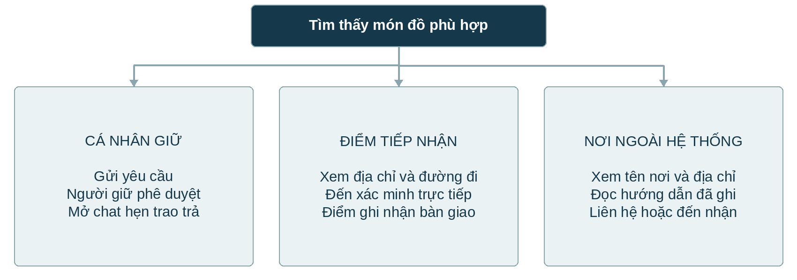
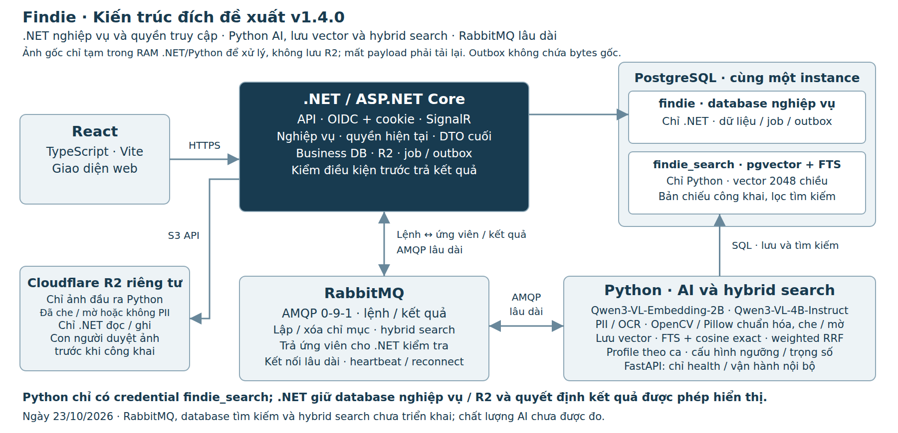

# Đặc tả ứng dụng Findie

Chức năng luồng nghiệp vụ và công nghệ lựa chọn

Phiên bản 1.4.0 · Ngày 23 tháng 10 năm 2026

Cập nhật triển khai 27/10/2026: API nghiệp vụ và worker text/ảnh qua Ollama đã có; chạy local theo [hướng dẫn](../guides/ai-service.md) và [spec 003](../specs/003-local-full-stack/spec.md). Những đoạn ghi “chưa triển khai” trong baseline thiết kế dưới đây phản ánh thời điểm ban hành, không thay cho kết quả kiểm thử runtime hiện tại. Chất lượng AI/GPU và các dịch vụ cloud thật chưa được xác nhận chỉ bởi test tích hợp.

## 1 Tổng quan và phạm vi

Findie kết nối người mất đồ, người nhặt được và các điểm tiếp nhận để tìm kiếm, xác minh và trao trả đồ thất lạc. Ứng dụng tập trung thông tin đang phân tán ở nhiều nhóm cộng đồng và hỗ trợ người tìm chỉ nhớ đặc điểm món đồ, kể cả khi không có ảnh.

Tài liệu này xác định chức năng, dữ liệu đầu vào, luồng xử lý, quy tắc nghiệp vụ và tiêu chí nghiệm thu cho MVP. Đối tượng sử dụng là nhóm sản phẩm, thiết kế, phát triển và kiểm thử.

**Trạng thái sản phẩm:** có demo ý tưởng, bộ khung React/.NET/FastAPI và notebook AI độc lập. Kiến trúc đích v1.4.0 ngày 23/10/2026 chốt Python xử lý AI/ảnh, lưu embedding và hybrid search; .NET quản lý nghiệp vụ/quyền/R2/job và DTO cuối. R2 chỉ lưu output Python: có nhạy cảm thì che/mờ, không phát hiện thì chuẩn hóa/encode sạch; tuyệt đối không upload original. Input chỉ tạm trong RAM ứng dụng rồi bỏ sau hoàn tất/lỗi/deadline, mất input phải tải lại. Hai database findie/findie_search cùng PostgreSQL instance, giao tiếp service qua RabbitMQ lâu dài. Luồng này chưa triển khai/benchmark; phần 2–7 vẫn phân biệt demo và MVP đề xuất.

### Mục tiêu

- Cho phép đăng thông tin đồ nhặt được kèm ảnh và nơi đang giữ.
- Hỗ trợ tìm bằng mô tả tiếng Việt hoặc ảnh, kết hợp khu vực và thời gian.
- Hướng dẫn nhận lại đồ theo đúng loại nơi giữ và kiểm soát việc kết nối hai bên.
- Ghi nhận tiếp nhận và bàn giao để thông tin nơi giữ phản ánh đúng thực tế.

### Tác nhân

| Tác nhân | Trách nhiệm chính | Phạm vi quyền đề xuất |
| --- | --- | --- |
| Người tìm | Tìm đồ, xem nơi giữ, gửi yêu cầu và nhận lại đồ | Xem tin công khai; quản lý yêu cầu và hội thoại của mình |
| Người nhặt hoặc người giữ | Đăng tin, cung cấp thông tin xác minh, xét yêu cầu, trao trả | Quản lý tin do mình đăng và yêu cầu liên quan |
| Nhân viên điểm tiếp nhận | Tiếp nhận đồ, xác minh trực tiếp, ghi nhận bàn giao | Chỉ thao tác đối với điểm được phân công |
| Nơi ngoài hệ thống | Là địa điểm giữ đồ được ghi trong bài đăng | Không mặc định có tài khoản hay chức năng quản trị |

Một người có thể vừa là người tìm vừa là người nhặt. Tài khoản và phân quyền là yêu cầu bổ sung cho MVP; demo chưa đặc tả màn đăng nhập. Phạm vi MVP chưa bao gồm thanh toán, phí chuộc đồ, vận chuyển hay tự động kết luận quyền sở hữu.

<!-- pagebreak -->

## 2 Danh mục chức năng

Các mã chức năng dưới đây dùng để đối chiếu giữa nghiệp vụ và tiêu chí nghiệm thu. “Theo demo” là hành vi được thể hiện bằng ảnh hoặc mô tả; không có nghĩa chức năng đã được triển khai.

| Mã | Chức năng | Căn cứ và phạm vi |
| --- | --- | --- |
| F01 | Đăng đồ nhặt được | Theo demo: tải ảnh, xem trước, mô tả, nơi và thời điểm nhặt, chọn nơi giữ |
| F02 | Tìm đồ thất lạc | Theo demo: tìm bằng mô tả hoặc ảnh, kèm khu vực và thời gian |
| F03 | Xem món đồ và cách nhận | Theo demo: thông tin món đồ, nơi giữ và bước nhận tương ứng |
| F04 | Gửi yêu cầu nhận đồ | Theo demo: áp dụng khi cá nhân giữ, có 0 đến 3 câu hỏi xác minh tùy chọn |
| F05 | Xét duyệt yêu cầu | Theo demo: người giữ xem câu trả lời rồi phê duyệt hoặc từ chối |
| F06 | Nhắn tin hẹn trao trả | Theo demo: mở chat sau phê duyệt để hai bên tự thỏa thuận |
| F07 | Chuyển vào điểm tiếp nhận | Demo nêu quy tắc chờ duyệt; các bước bàn giao chi tiết là đề xuất |
| F08 | Nhận tại điểm tiếp nhận | Theo demo: xem địa chỉ, xem đường đi, xác minh trực tiếp, ghi nhận bàn giao |
| F09 | Nhận tại nơi ngoài hệ thống | Theo demo: xem tên nơi giữ, địa chỉ và hướng dẫn đã ghi |
| F10 | Tài khoản và phân quyền | Đề xuất MVP để bảo vệ bài đăng, yêu cầu, bằng chứng và tin nhắn |
| F11 | Bảo vệ ảnh trước công khai | Yêu cầu bổ sung: lưu R2, Qwen gợi ý vùng nhạy cảm, OpenCV làm mờ/che và người dùng kiểm tra bản sạch |

### Màn hình chính

1. **Tìm kiếm:** nhập thông tin mất đồ, xem kết quả và chi tiết món đồ.
2. **Đăng tin:** nhập thông tin đồ nhặt được, nơi giữ và câu hỏi xác minh nếu có.
3. **Yêu cầu nhận đồ:** gửi yêu cầu, xem trạng thái và xét duyệt theo vai trò.
4. **Hội thoại:** nhắn tin trong các yêu cầu đã được duyệt.
5. **Tiếp nhận và bàn giao:** dành cho nhân viên điểm được phân quyền.

Demo có mục điều hướng “Hồ sơ”. Nội dung quản lý tài khoản, lịch sử bài đăng và lịch sử yêu cầu trong mục này cần được chốt riêng; không suy ra toàn bộ chức năng chỉ từ nhãn điều hướng.

### Ranh giới nghiệp vụ

Kết quả tìm kiếm chỉ gợi ý món đồ có đặc điểm tương tự. Người giữ hoặc nhân viên điểm tiếp nhận chịu trách nhiệm xác minh trước khi trao trả. Findie ghi nhận thông tin và hỗ trợ kết nối; điểm tương đồng do AI tính không thay thế bước xác minh.

<!-- pagebreak -->

## 3 Đăng tin đồ nhặt được

**Chức năng:** F01. **Tác nhân:** người nhặt hoặc người giữ. **Kết quả:** có bài đăng hiển thị thông tin món đồ và nơi giữ hiện tại.

### Luồng chính

1. Người dùng mở Đăng tin và chọn ảnh từ thiết bị.
2. Hệ thống hiển thị ảnh xem trước để người dùng kiểm tra.
3. Người dùng bổ sung mô tả, nơi nhặt, ngày và khoảng giờ nhặt.
4. Người dùng chọn Tự giữ để trả, Nơi ngoài hệ thống hoặc Điểm tiếp nhận.
5. Người dùng kiểm tra thông tin và gửi đăng tin.
6. Hệ thống kiểm tra dữ liệu, lưu bài đăng và hiển thị kết quả. Nếu gửi vào điểm tiếp nhận, xử lý theo phần 6.
7. Theo yêu cầu bổ sung cho MVP, ảnh gốc chỉ giữ tạm để Python kiểm tra; có nhạy cảm thì tạo ảnh che/mờ, không phát hiện thì chuẩn hóa/encode lại và bỏ EXIF. .NET chỉ lưu output vào R2 riêng tư; original không lưu R2 và bị bỏ sau request. Người có quyền kiểm output trước công khai; khi AI lỗi không tạo được output hợp lệ thì không ghi R2 cho lần đó và dùng placeholder.

### Dữ liệu đầu vào

| Trường | Nội dung | Quy tắc MVP đề xuất |
| --- | --- | --- |
| Ảnh món đồ | Ảnh chụp đồ nhặt được | Ít nhất 1 ảnh; JPEG, PNG hoặc WebP; tối đa 10 MB mỗi ảnh |
| Mô tả | Loại đồ, màu sắc, đặc điểm nhìn thấy | Bắt buộc; không công khai thông tin dùng để xác minh chủ sở hữu |
| Nơi nhặt | Khu vực hoặc địa điểm tìm thấy | Bắt buộc; tách với nơi đang giữ |
| Thời điểm nhặt | Ngày và khoảng giờ | Ngày bắt buộc; cho phép đánh dấu không nhớ giờ chính xác |
| Loại nơi giữ | Cá nhân, điểm tiếp nhận, ngoài hệ thống | Chọn 1 loại; không đổi nơi giữ chỉ vì gửi yêu cầu tiếp nhận |
| Thông tin nơi giữ | Điểm trong danh sách hoặc tên nơi, địa chỉ, hướng dẫn | Địa chỉ công khai dành cho điểm hoặc nơi ngoài hệ thống |
| Câu hỏi xác minh | Đặc điểm riêng để người nhận trả lời | Từ 0 đến 3 câu hỏi, tùy chọn; cách tạo là đề xuất MVP |

Các giới hạn dung lượng và tính bắt buộc ở bảng là cấu hình nghiệp vụ đề xuất, chưa phải ràng buộc đã được demo xác nhận.

### Ngoại lệ đề xuất cho MVP

- Tệp sai định dạng hoặc quá dung lượng: báo lỗi tại trường ảnh và giữ các dữ liệu đã nhập.
- Tải ảnh hoặc đăng tin thất bại: không báo đăng thành công; cho phép gửi lại mà không tạo bài trùng.
- Khoảng giờ không hợp lệ hoặc ngày trong tương lai: yêu cầu sửa trước khi gửi.
- Chọn nơi ngoài hệ thống nhưng thiếu địa chỉ: yêu cầu bổ sung để người tìm biết nơi đến nhận.
- Qwen/OpenCV lỗi: không lưu input gốc trên R2, bỏ buffer khi kết thúc và cho tải lại; khi output còn chờ duyệt dùng placeholder. Bài đăng/mô tả hợp lệ có thể giữ riêng; chỉ output được duyệt mới lập chỉ mục ảnh.

<!-- pagebreak -->

## 4 Tìm kiếm và xem kết quả

**Chức năng:** F02 và F03. **Tác nhân:** người tìm. **Kết quả:** danh sách gợi ý kèm nơi giữ và bước nhận phù hợp.

### Luồng chính

1. Người tìm thêm ảnh nếu có hoặc nhập mô tả tiếng Việt về các đặc điểm còn nhớ.
2. Người tìm cung cấp khu vực, ngày và khoảng giờ làm mất.
3. Hệ thống tìm món đồ phù hợp. MVP đề xuất kiểm tra điều kiện đầu vào và chỉ tìm trong các bài đăng còn hiệu lực.
4. Hệ thống hiển thị các món được gợi ý với ảnh, mô tả, thông tin nhặt được và nơi đang giữ.
5. Người tìm mở chi tiết và tiếp tục theo một trong ba nhánh nhận đồ.

Ví dụ đầu vào trong demo là “Ví đen, khóa kéo vàng, không có dây đeo”, khu vực Công viên Bờ Sông, ngày 13/10/2026 và khoảng giờ 16:30 đến 17:30. Đây là dữ liệu minh họa.

### Quy tắc tìm kiếm

- Ảnh không bắt buộc. Khi không có ảnh, mô tả phải đủ để thực hiện tìm kiếm.
- MVP đề xuất yêu cầu có ít nhất một trong hai dữ liệu: ảnh hợp lệ hoặc mô tả không rỗng.
- Khi cung cấp cả ảnh và mô tả, MVP cho chọn Tìm theo ảnh hoặc Tìm theo mô tả. Việc trộn điểm giữa hai chế độ cần được đánh giá trước khi bổ sung.
- Khu vực, ngày và khoảng giờ được sử dụng để thu hẹp hoặc hỗ trợ xếp hạng. Cách mở rộng phạm vi phải hiển thị cho người dùng, không âm thầm loại toàn bộ kết quả vì thời gian chỉ là ước lượng.
- Các cách gọi như “ví” và “bóp” là tình huống cần kiểm thử; chưa coi khả năng hiểu đồng nghĩa là kết quả đã được chứng minh.

| Nơi đang giữ | Thông tin cần hiển thị | Hành động tiếp theo |
| --- | --- | --- |
| Cá nhân | Thông tin món đồ và trạng thái có thể yêu cầu | Gửi yêu cầu nhận đồ |
| Điểm tiếp nhận | Tên điểm, địa chỉ, hướng dẫn và trạng thái giữ | Xem đường đi, đến xác minh |
| Nơi ngoài hệ thống | Tên nơi, địa chỉ và hướng dẫn đã ghi | Liên hệ hoặc đến theo hướng dẫn |

### Xử lý không có kết quả đề xuất cho MVP

Hệ thống cho biết chưa tìm thấy món phù hợp và cho phép sửa mô tả, đổi ảnh hoặc mở rộng khu vực, thời gian. Không tạo kết quả giả. Nếu mô hình tìm kiếm lỗi, thông báo rõ và cho phép xem danh sách theo bộ lọc cơ bản.

<!-- pagebreak -->

## 5 Yêu cầu nhận đồ và nhắn tin

**Chức năng:** F04, F05 và F06. **Điều kiện:** món đồ hiện do cá nhân giữ và còn có thể nhận lại. Luồng này không áp dụng mặc định cho đồ đang ở điểm tiếp nhận hoặc nơi ngoài hệ thống.

### Gửi và xét duyệt yêu cầu

1. Người tìm mở chi tiết món đồ và chọn Gửi yêu cầu nhận đồ.
2. Hệ thống hiển thị câu hỏi xác minh nếu có. Demo cho phép từ 0 đến 3 câu hỏi; không có câu hỏi vẫn gửi được yêu cầu.
3. Người tìm gửi câu trả lời và yêu cầu. Hệ thống lưu trạng thái Chờ xét duyệt.
4. Người giữ xem yêu cầu và các câu trả lời đã gửi.
5. Người giữ chọn Phê duyệt hoặc Từ chối. Hệ thống lưu quyết định và cập nhật trạng thái.
6. Khi được phê duyệt, hai bên có quyền mở hội thoại để thỏa thuận thời gian, địa điểm và cách trao trả.

MVP đề xuất yêu cầu trả lời các câu hỏi đã được người giữ thiết lập. Quy tắc này cần được xác nhận vì demo chỉ xác nhận việc có câu hỏi là tùy chọn.

### Điều kiện mở chat

| Trạng thái yêu cầu | Người tìm và người giữ | Người không thuộc yêu cầu |
| --- | --- | --- |
| Chờ xét duyệt | Chưa được mở hoặc gửi tin | Không được truy cập |
| Đã phê duyệt | Được đọc và gửi tin trong hội thoại tương ứng | Không được truy cập |
| Bị từ chối | Chưa mở kết nối | Không được truy cập |

Quyền chat phải được kiểm tra tại backend khi kết nối, đọc và gửi tin nhắn. Việc ẩn nút trên giao diện không đủ để thực thi quy tắc này.

### Bàn giao và ngoại lệ

Demo minh họa việc hẹn nhận lúc 18:00 qua tin nhắn. MVP sử dụng hội thoại để thỏa thuận; chưa đặc tả lịch hẹn riêng, đính kèm hoặc chia sẻ vị trí trong chat.

Để kết thúc vòng đời món đồ, MVP đề xuất người giữ ghi nhận đã trao trả và thời điểm bàn giao. Một yêu cầu được duyệt chưa có nghĩa món đồ đã được trả. Hệ thống phải ngăn thao tác bàn giao lần thứ hai. Cách chọn giữa nhiều người cùng yêu cầu, rút yêu cầu và thu hồi phê duyệt cần được chốt trước triển khai.

<!-- pagebreak -->

## 6 Điểm tiếp nhận và nơi ngoài hệ thống

**Chức năng:** F07, F08 và F09. Hai loại nơi giữ này cung cấp hướng dẫn đến nhận trực tiếp; không mặc định mở chat giữa người tìm và người đã đăng tin.

### Chuyển đồ vào điểm tiếp nhận

Demo xác nhận quy tắc: khi còn chờ điểm duyệt tiếp nhận, nơi đang giữ chưa thay đổi. Luồng hoàn chỉnh sau đây là đề xuất MVP nhằm bảo đảm thông tin trên ứng dụng khớp với bàn giao thực tế.

1. Người giữ chọn điểm tiếp nhận và gửi yêu cầu chuyển món đồ đến điểm.
2. Hệ thống tạo yêu cầu Chờ tiếp nhận; món đồ vẫn thuộc nơi giữ hiện tại.
3. Nhân viên điểm kiểm tra yêu cầu và món đồ được bàn giao thực tế.
4. Chỉ khi nhân viên xác nhận đã tiếp nhận thực tế, hệ thống mới đổi nơi giữ sang điểm và ghi lịch sử.
5. Nếu điểm từ chối hoặc yêu cầu còn chờ, hệ thống giữ nguyên nơi giữ hiện tại.

Việc điểm đồng ý trước về mặt thủ tục không tự xác nhận đã cầm giữ đồ. Cách tổ chức bước đồng ý trước cần được nhóm dự án chốt nếu có sử dụng.

### Nhận lại đồ tại điểm

1. Người tìm xem mã món đồ, ảnh, tên điểm, địa chỉ và hướng dẫn nhận.
2. Người tìm chọn Xem đường đi; MVP đề xuất mở liên kết chỉ đường bằng địa chỉ.
3. Người tìm đến quầy và cung cấp thông tin để nhân viên xác minh trực tiếp.
4. Nếu đủ căn cứ, nhân viên trao đồ và ghi nhận đã bàn giao.
5. MVP đề xuất cập nhật trạng thái, lưu người thực hiện và thời điểm, ngừng hiển thị món đồ trong danh sách có thể nhận.

Nếu xác minh không đạt, không ghi nhận bàn giao. Bộ bằng chứng cần xuất trình và cách xử lý tranh chấp là quy trình vận hành cần xác nhận, không được suy ra từ điểm tương đồng tìm kiếm.

### Nhận lại đồ tại nơi ngoài hệ thống

Người tìm xem tên nơi giữ, địa chỉ và hướng dẫn do người đăng cung cấp, sau đó liên hệ hoặc đến nhận theo hướng dẫn. Ứng dụng không mặc định có quyền duyệt hay xác nhận thay cho nơi đó. MVP đề xuất người đăng cập nhật tình trạng sau khi có thông tin bàn giao; không tự động đánh dấu đã trả chỉ vì người tìm mở chỉ đường.

<!-- pagebreak -->

## 7 Quy tắc và trạng thái nghiệp vụ

### Sơ đồ nhận lại đồ

### Quy tắc bắt buộc theo demo

- **BR01:** người mất được tìm bằng mô tả khi không có ảnh.
- **BR02:** cách nhận tiếp theo được xác định bằng nơi đang giữ hiện tại.
- **BR03:** có từ 0 đến 3 câu hỏi xác minh tùy chọn; 0 câu hỏi vẫn gửi yêu cầu được.
- **BR04:** yêu cầu do cá nhân giữ phải được phê duyệt trước khi mở chat; từ chối chưa mở kết nối.
- **BR05:** chờ điểm duyệt tiếp nhận không làm thay đổi nơi giữ hiện tại.
- **BR06:** đồ tại điểm được xác minh và trao trả trực tiếp; điểm ghi nhận đã bàn giao.

### Mô hình trạng thái đề xuất

| Đối tượng | Trạng thái và chuyển đổi | Điều kiện chính |
| --- | --- | --- |
| Yêu cầu nhận | Chờ xét duyệt → Đã phê duyệt hoặc Bị từ chối | Người đang giữ có quyền quyết định |
| Chuyển vào điểm | Chờ tiếp nhận → Đã tiếp nhận hoặc Bị từ chối | Chỉ đổi nơi giữ khi đã nhận thực tế |
| Món đồ | Đang giữ → Đã trao trả | Phải có người có quyền xác nhận bàn giao |

Các trạng thái là mô hình đề xuất để triển khai. Trạng thái yêu cầu, trạng thái tiếp nhận và trạng thái món đồ được lưu riêng để tránh hiểu “đã duyệt” thành “đã trả”. Loại nơi giữ là một thuộc tính riêng của món đồ.

**Bất biến MVP đề xuất:** mỗi món đồ chỉ có một nơi giữ hiện tại và chỉ có một lần bàn giao hoàn tất. Các cập nhật nơi giữ, trạng thái và lịch sử liên quan phải được lưu trong cùng một giao dịch dữ liệu.

<!-- pagebreak -->

## 8 Dữ liệu và quyền truy cập

Mô hình dưới đây là thiết kế logic đề xuất cho MVP, không phải cấu trúc cơ sở dữ liệu đã có của demo.

| Thực thể | Thuộc tính chính | Quan hệ |
| --- | --- | --- |
| Tài khoản | Mã, tên hiển thị, issuer và subject của OIDC | Có nhiều bài đăng và yêu cầu; không tự lưu mật khẩu trong thiết kế đề xuất |
| Món đồ | Mã, mô tả, nơi nhặt, thời điểm, loại nơi giữ, nơi giữ hiện tại, trạng thái | Có ảnh, câu hỏi và yêu cầu |
| Đối tượng R2 | Bucket/key, chủ sở hữu, MIME, byte/pixel, hash và trạng thái output | Chỉ dự trữ/upload sau Python trả ảnh hợp lệ; mỗi phiên bản có một processed output, không original object |
| Ảnh | Mã món đồ, processed_object_id, thứ tự, phiên bản và xử lý/duyệt | Không giữ cặp original/sanitized; chỉ output được duyệt hiển thị và lập chỉ mục |
| Điểm tiếp nhận | Mã, tên, địa chỉ, hướng dẫn | Có nhân viên và đồ đang giữ |
| Phân công tại điểm | Tài khoản, điểm, quyền | Giới hạn phạm vi thao tác nhân viên |
| Câu hỏi xác minh | Mã món đồ, nội dung, thứ tự | Tối đa 3 câu mỗi món |
| Yêu cầu nhận | Món đồ, người yêu cầu, câu trả lời, trạng thái, người duyệt, thời điểm | Có tối đa một hội thoại cho một yêu cầu được duyệt |
| Hội thoại và tin nhắn | Yêu cầu, người gửi, nội dung, thời điểm | Chỉ hai bên được phép truy cập |
| Yêu cầu tiếp nhận | Món đồ, nơi giữ cũ, điểm đích, trạng thái | Không thay nơi giữ trong lúc chờ |
| Lịch sử bàn giao | Món đồ, nơi giao và nhận, người xác nhận, thời điểm | Ghi nhận thay đổi nơi giữ hoặc hoàn tất trả |
| Hồ sơ mô hình và vector | Tên/revision Qwen, profile, 2048 chiều, source/document version | Python sở hữu trong findie_search; chỉ mô tả công khai/ảnh sạch đã duyệt; không giữ vector truy vấn tạm |
| Tác vụ nền | Job, lease/retry và outbox snapshot/tombstone theo phiên bản | .NET sở hữu nguồn và ý định đồng bộ; Python commit kho tìm kiếm trước biên nhận, .NET hoàn tất job riêng |

[Thiết kế dữ liệu đích](../database/database-design.md) tách findie (.NET) và findie_search (Python). [DDL](../database/database-schema.sql), [từ điển cột](../database/database-column-dictionary.md) và [ERD](../database/findie-erd.drawio) hiện là snapshot bootstrap 16 bảng/164 cột: còn item_embeddings trong nghiệp vụ và original_object_id bắt buộc/cặp original–sanitized, không tương thích chính sách chỉ lưu processed output 1.4.0. Cần migration kho tìm kiếm/outbox và mô hình ảnh một processed_object_id, cùng DDL/ERD/kiểm thử cập nhật; không có di trú hoặc xóa R2 thật trong lần sửa tài liệu này.

### Phân loại thông tin

Thông tin công khai gồm bản ảnh sạch đã xử lý và được duyệt, mô tả công khai, khu vực nhặt, thời điểm, trạng thái và hướng dẫn nơi nhận. Không công khai địa chỉ nhà của cá nhân, nội dung chat hoặc câu trả lời xác minh. Câu trả lời chỉ được chia sẻ với người yêu cầu và người có quyền xét duyệt; không đưa vào vector tìm kiếm công khai.

Người dùng chỉ được sửa bài đăng, đọc yêu cầu và hội thoại thuộc phạm vi quyền của mình. Nhân viên điểm chỉ được xác nhận đồ tại điểm được phân công. Quyền nhân viên phải do hệ thống cấp, không lấy từ giá trị người dùng tự gửi lên.

### Tính nhất quán

Backend .NET kiểm quyền/trạng thái và giao dịch nghiệp vụ để ngăn hai nơi giữ/hai lần trả. Chỉ output đã xử lý mới được đăng ký/upload R2, sau đó lưu metadata/liên kết và index outbox. Thay đổi nội dung/ảnh/quyền duyệt phải tăng phiên bản và ghi snapshot/tombstone cùng nghiệp vụ; Python lưu vector có điều kiện theo watermark. Thu hồi hiển thị có hiệu lực ở nguồn chuẩn ngay, .NET loại ứng viên cũ dù chỉ mục chậm. R2, nghiệp vụ và kho tìm kiếm không cùng transaction; retry bền vững chỉ bắt đầu từ output đã lưu, không hứa phục hồi raw đã mất.

<!-- pagebreak -->

## 9 Công nghệ và kiến trúc hệ thống

Bộ nền tảng đã chọn gồm React, .NET, Python, RabbitMQ, PostgreSQL và Cloudflare R2. Python xử lý toàn bộ AI/ảnh, trực tiếp lưu embedding và tìm kiếm hybrid; .NET thực hiện nghiệp vụ/phân quyền và kiểm tra kết quả hiện tại. Vector database tiếp tục dùng PostgreSQL + pgvector, tách database/credential cho Python trên cùng instance. Thư viện, revision và cấu hình xếp hạng là đề xuất cần ghim, kiểm thử và benchmark; chưa có cam kết chất lượng/độ trễ/chi phí.

| Thành phần | Công nghệ dự kiến | Vai trò |
| --- | --- | --- |
| Giao diện | React, TypeScript, Vite, HTML/CSS | Web responsive, biểu mẫu dễ tiếp cận [T1] |
| Giao tiếp trình duyệt | Fetch API, HTTPS/JSON, @microsoft/signalr | Gọi API và nhận sự kiện chat |
| API nghiệp vụ | C#, .NET, ASP.NET Core Web API | Xác thực, quyền, bài đăng, nhận đồ, tiếp nhận và trả đồ [T2] |
| Đăng nhập | ASP.NET Core OpenID Connect và Cookie Authentication | Đề xuất OIDC với phiên cookie; DB lưu issuer/subject; nhà cung cấp còn chờ chọn |
| Dữ liệu nghiệp vụ | PostgreSQL, database findie | Chỉ .NET: nguồn nghiệp vụ, lịch sử, tin nhắn, metadata R2 và job/outbox |
| Truy cập dữ liệu | Entity Framework Core, Npgsql, migrations | Giao dịch, kiểm soát đồng thời và quản lý lược đồ [T4] |
| Vector database | PostgreSQL + pgvector, findie_search; psycopg 3, pgvector-python | Chỉ Python: lưu/đọc vector(2048), bản chiếu công khai và FTS; chưa triển khai [T5, T17] |
| Hybrid search | Python; cosine exact + PostgreSQL FTS + weighted RRF | Python truy hồi/hợp nhất ứng viên, cấu hình và mục tiêu theo từng trường hợp [T5, T15, T16] |
| AI service | Python AI worker, aio-pika, Pydantic; FastAPI/Uvicorn cho health/ops | Embedding, nhận diện/OCR, xử lý ảnh, lưu vector và hybrid search; lệnh/kết quả qua RabbitMQ [T3, T14] |
| Giao tiếp .NET và Python | RabbitMQ, AMQP 0-9-1; RabbitMQ.Client, aio-pika | Kết nối/channel lâu dài; heartbeat, reconnect; lệnh và kết quả bất đồng bộ có publisher confirms/manual ACK [T12–T14] |
| Inference | PyTorch, Transformers, Accelerate, qwen-vl-utils | Nạp hai mô hình Qwen; dùng mã inference chính thức được rà soát và ghim revision |
| Tìm kiếm text/ảnh | Qwen/Qwen3-VL-Embedding-2B | Một model chung cho text và ảnh, baseline 2048 chiều [T6] |
| Gợi ý vùng nhạy cảm | Qwen/Qwen3-VL-4B-Instruct | Bản Instruct 4B đã chọn; gợi ý vùng cần che/mờ từ OCR/định vị, không tự kết luận an toàn [T7] |
| Xử lý ảnh | OpenCV (opencv-python-headless), NumPy, Pillow trong Python | Kiểm MIME thực/giải mã/pixel, chuẩn hóa hướng/resize, GaussianBlur hoặc che kín, bỏ EXIF/GPS và mã hóa bản sạch [T9] |
| Kho ảnh | Cloudflare R2, S3 API, AWSSDK.S3 | Chỉ .NET lưu output Python đã che/mờ hoặc không PII; không có original/temp input R2 [T10] |
| Điều phối tác vụ nền | BackgroundService, RabbitMQ.Client của .NET; PostgreSQL | .NET ghi job/outbox và nhận biên nhận; Python commit kho tìm kiếm trước; .NET quản lý trạng thái/retry và dọn R2 |
| Chat | ASP.NET Core SignalR | Lưu tin nhắn trước khi phát; kiểm tra quyền từng thao tác [T8] |
| Chỉ đường | Liên kết bản đồ | Mở địa chỉ có sẵn, chưa cần Maps SDK |
| Vận hành | Git, Docker, Docker Compose, HTTPS, AMQPS | Mạng riêng; broker có volume, ACL/TLS, giới hạn queue và retention/DLQ; theo dõi health, reconnect và tồn đọng |
| Kiểm thử | xUnit, ASP.NET Core integration testing, pytest, Playwright | API/DB, xử lý ảnh/AI và hành trình web |
| Thiết kế dữ liệu | SQL, diagrams.net/draw.io | DDL và ERD chỉnh sửa được |

Hai model card Qwen công bố Apache-2.0 [T6, T7]; cần ghim trọng số, mã inference, processor/prompt và phiên bản gói. Không thêm Redis, Kafka, Elasticsearch, sản phẩm/máy chủ vector DB khác hoặc reranker cho baseline. Database tìm kiếm riêng dùng PostgreSQL hiện có.

### Kiến trúc triển khai

React gọi .NET qua HTTPS/SignalR. .NET kiểm phiên/quyền/nghiệp vụ, đọc ghi database findie, quản lý R2 và gửi lệnh qua RabbitMQ. Python xử lý ảnh/embedding, ghi trực tiếp findie_search và thực hiện hybrid search; không trả vector để .NET lưu/tìm. Python trả ứng viên đã xếp hạng và nguồn/phiên bản; .NET kiểm điều kiện hiện tại rồi lấy thông tin nghiệp vụ để trả DTO. Python không có credential findie/R2; .NET không tạo/ghi/truy vấn vector hoặc xếp hạng hybrid.

MVP có React, một bản chạy .NET, một Python AI service có FastAPI health/ops, RabbitMQ, một PostgreSQL instance với hai database findie/findie_search và Cloudflare R2. Credential/role tách theo service; không truy cập chéo DB. Python không sở hữu quyền chat, duyệt hoặc bàn giao. Compose hiện tại mới chạy database bootstrap; chưa có RabbitMQ, search store hoặc hybrid search. HTTP probe hiện hữu chỉ kiểm tra trạng thái. Mở rộng nhiều bản chạy phải giải quyết định tuyến reply/SignalR.

### Kết nối RabbitMQ và hợp đồng dữ liệu

Mỗi tiến trình .NET và Python mở một kết nối TCP/AMQP đến RabbitMQ khi khởi động, giữ channel publish/consume riêng và tái sử dụng cho nhiều tác vụ. Đây là hai kết nối đến broker, không phải socket trực tiếp giữa hai dịch vụ. Dùng heartbeat, thử kết nối ban đầu khi broker chưa sẵn sàng, reconnect có backoff/jitter và phục hồi topology/consumer. Python chạy inference ngoài vòng lặp I/O để không chặn heartbeat; ban đầu giới hạn đồng thời theo VRAM. Không tạo connection hoặc queue cho từng truy vấn [T12–T14].

Baseline dùng exchange lâu dài findie.ai.commands/findie.ai.results. Lệnh index.upsert/index.remove và tìm text search.hybrid đi các queue chỉ mục/search bền vững; kết quả chỉ mục/ứng viên có confirm/mandatory và ACK sau commit. Raw image.redact và search.hybrid.image đi queue tạm exclusive/non-durable/auto-delete do Python khai báo, tên do broker sinh, nonpersistent/TTL hữu hạn; không tạo queue theo từng ảnh và không body DLQ/tracing/backup raw. Mất worker/queue hoặc deadline thì bỏ payload, chỉ giữ mã lỗi an toàn và yêu cầu tải lại nếu input không còn RAM. Không dùng non-durable non-exclusive đã bị hạn chế ở RabbitMQ mới. Transient không bảo đảm chỉ RAM tại broker [T12, T13, T18].

Hợp đồng gồm schema_version, operation, correlation_id/deadline; job chỉ mục có job_id/lease, document/source version/hash và model/profile. Snapshot/manifest cho index.upsert chỉ tham chiếu output đã lưu/duyệt; index.remove mang ID/version tombstone. Raw input không có R2 key và không nằm trong outbox/job. search.hybrid trả ứng viên có ID/hạng/phiên bản/profile, ảnh trả output và metadata hợp lệ; không trả vector để .NET lưu/tìm. Bytes ảnh dùng body nhị phân, baseline 10 MiB/body, metadata JSON header 16 KiB đề xuất; dữ liệu dài dùng body JSON riêng. Không base64, URL tùy ý, OCR/raw trong log hoặc kho tìm kiếm.

Broker nằm mạng riêng, AMQPS/ACL/vhost theo service, giới hạn queue/prefetch/deadline. Cấm raw body trong log/DLQ/backup; message ảnh tạm vẫn có thể bị RabbitMQ page xuống đĩa, TTL/ACK chỉ mô tả vòng đời logic, không bảo đảm xóa vật lý tức thì [T18]. Bỏ input ở .NET/Python trong cleanup; tránh upload/proxy/multipart tự spool ra đĩa ứng dụng. Luồng chỉ mục/output có retention/backup riêng. Reconnect/ACK không khôi phục ảnh tạm đã mất; người dùng tải lại, còn nguồn output đã lưu mới đủ retry bền vững.

<!-- pagebreak -->

## 10 Tìm kiếm thông minh và yêu cầu chất lượng

### R2 chỉ lưu ảnh đầu ra, ảnh gốc bị loại bỏ

**Ảnh gốc do người dùng tải lên không được ghi R2, kể cả bucket riêng tư hoặc prefix tạm.** .NET nhận bytes có trần dung lượng vào RAM, gửi qua luồng RabbitMQ ảnh tạm cho Python; không dùng upload/multipart hoặc reverse proxy tự spool ra đĩa. Python giải mã/kiểm tệp trong bộ nhớ và trả ảnh đầu ra. Cả hai service bỏ reference/buffer input trong cleanup sau thành công, lỗi hoặc deadline; thu hồi preview/object URL của ứng dụng khi xong. Quy tắc này không xóa tệp gốc do người dùng giữ trên thiết bị.

| Kết quả kiểm tra Python | Ảnh được .NET lưu R2 | Xử lý ảnh gốc |
| --- | --- | --- |
| Có vùng nhạy cảm | OpenCV làm mờ/che kín vùng đã kiểm; chuẩn hóa, encode lại và bỏ EXIF/GPS | Không upload R2; bỏ buffer sau xử lý |
| Không phát hiện vùng nhạy cảm và kiểm tệp hợp lệ | Ảnh được chuẩn hóa/encode lại, bỏ EXIF/GPS; không cần làm mờ pixel | Không giữ thêm bản raw; bỏ buffer sau xử lý |
| Tệp không hợp lệ, AI/JSON/OpenCV lỗi hoặc không tạo được output hợp lệ | Không ghi R2 cho lần xử lý đó; báo lỗi/giữ placeholder | Bỏ input khi kết thúc; mất input hoặc hết hạn thì yêu cầu tải lại |

.NET chỉ **sau khi nhận output hợp lệ** mới dự trữ `stored_objects` cho ảnh đầu ra, tạo key ngẫu nhiên dưới `processed/`, upload ngoài transaction DB rồi ghi metadata/hash/kích thước và liên kết ảnh. Không có object/prefix `original/` hoặc `temporary/` chứa input; ảnh truy vấn cũng không ghi R2. Mỗi ảnh nghiệp vụ tham chiếu một `processed_object_id` hiện hành (tên đích đề xuất), không có FK nguồn original. Thay thế tạo output version mới, dọn output cũ theo retention; không giữ một cặp raw/blur.

Dùng bucket private, tắt public `r2.dev`/custom domain, .NET dùng credential/SDK giới hạn; Python không có credential R2 [T10]. Chỉ output đã duyệt đúng nguồn/phiên bản mới được hiển thị và tạo embedding ảnh công khai. Endpoint có quyền chỉ xem output; không tồn tại API tải lại original. Presigned URL nếu bổ sung chỉ cho output đủ điều kiện, thời hạn ngắn [T11]. Trước khi upload hoàn tất, output cũng chỉ trong RAM: crash có thể phải tải lại, không hứa phục hồi từ object chưa tồn tại.

### Nhận diện, làm mờ và kiểm tra đầu ra

`Qwen3-VL-4B-Instruct` chỉ gợi ý vùng khuôn mặt, giấy tờ/thẻ, điện thoại/địa chỉ và QR/barcode nhạy cảm. Python kiểm schema/nhãn/tọa độ hữu hạn và quy đổi theo ảnh đã chuẩn hóa; OpenCV làm mờ, che kín chữ/mã khi blur còn đọc được. Không coi output mô hình là lệnh hay bảo đảm ẩn danh. Kết quả không có vùng nhạy cảm vẫn qua encode/loại metadata; **AI lỗi khác với không phát hiện nhạy cảm**.

Output hợp lệ được lưu R2 riêng tư ở trạng thái chờ duyệt. Người có quyền chỉ kiểm bản đầu ra và bổ sung vùng che nếu còn sót; thao tác thêm che chạy trong Python trên output hiện có rồi thay phiên bản. Không hỗ trợ khôi phục/unblur từ original đã bỏ; cần nguồn rõ hơn thì người dùng tải lại. Duyệt không được bỏ qua xử lý bằng cách đổi nhãn raw thành output. Chính sách ai được duyệt vẫn cần chốt.

Chỉ output **đã duyệt và khớp phiên bản hiện tại** được công khai/embedding; lúc chờ, lỗi hoặc bị từ chối dùng placeholder. Bài đăng/mô tả hợp lệ có thể lưu độc lập khi ảnh lỗi; không giữ original để tự retry sau khởi động lại. Cần kiểm cả cổng upload, proxy, decoder và log để bảo đảm ứng dụng không tạo bản sao input ngoài vòng đời tạm.

### Lập chỉ mục và đồng bộ nguồn

.NET lưu bài đăng/mô tả hợp lệ độc lập khi ảnh chờ/lỗi. Input ảnh chỉ RAM/request và image.redact tạm; không ghi raw vào ai_jobs/outbox. Chỉ sau output Python hợp lệ được upload R2 và duyệt đúng phiên bản mới tạo outbox lập chỉ mục ảnh bền vững; text công khai có thể lập chỉ mục độc lập. ai_jobs/bootstrap chưa đủ lược đồ processed-only/outbox đích. Python tạo embedding ngoài SQL transaction rồi commit vector/projection/FTS tại findie_search trước receipt; .NET hoàn tất job trong transaction riêng. Crash mất raw/output chưa upload thì yêu cầu tải lại; output đã lưu/duyệt cho phép retry index từ R2.

Mọi sửa/ẩn/gỡ/trao trả, đổi nơi giữ hoặc thu hồi duyệt phải tạo snapshot mới hoặc tombstone bền vững cùng nghiệp vụ. Python lưu watermark đơn điệu và snapshot hash; nhiều source job text/ảnh có ID riêng được tham chiếu cùng manifest, nhưng cùng document_version khác snapshot là xung đột. Trước commit kết quả inference, kiểm lại document/source version dưới khóa hoặc cập nhật có điều kiện; tombstone ngăn lệnh cũ hồi sinh dữ liệu. Bỏ receipt cũ ở .NET không tự xóa vector đã ghi. Cần đối soát/rebuild, retry/backoff hữu hạn, idempotency, ACK sau commit và giữ ý định xử lý khi broker/search DB lỗi. Không mở transaction SQL trong lúc suy luận.

### Lưu vector và hybrid search do Python đảm nhận

**Python AI service đảm nhận cả lưu embedding và hybrid search trong vector database.** .NET nhận truy vấn từ React, kiểm dữ liệu/bộ lọc và chuyển `search.hybrid` qua RabbitMQ; không lấy vector về để tự tìm. Python trả danh sách ứng viên có thứ hạng, .NET kiểm điều kiện nghiệp vụ hiện tại rồi lấy thông tin món đồ từ database nghiệp vụ để trả giao diện.

Mô tả tiếng Việt không rỗng hoặc ảnh hợp lệ là đầu vào; tìm chỉ bằng mô tả vẫn là quy tắc cốt lõi. Nếu có cả ảnh và mô tả, baseline tiếp tục chọn một chế độ. Hybrid ở đây kết hợp **từ khóa và ngữ nghĩa** khi có văn bản; không tự bật trộn điểm vector text–image hoặc tìm chéo phương thức. Ảnh đơn thuần dùng vector ảnh cùng bộ lọc cấu trúc; không bịa từ khóa/OCR để coi như có nhánh lexical.

### Thuật toán hybrid search cơ sở

1. Python chọn `search_profile_id`/phiên bản từ quy tắc đầu vào đã kiểm chứng, tạo vector truy vấn tạm bằng `Qwen3-VL-Embedding-2B`, kiểm cấu hình tương thích và chuẩn hóa L2. Chỉ tìm trong vector cùng modality, model/revision, `processing_profile`, 2048 chiều và nguồn hiện hành trong bản chiếu.
2. Áp dụng bộ lọc công khai, chưa trao trả, trạng thái ảnh/duyệt, khu vực và khoảng thời gian vào **cả hai nhánh trước khi giới hạn ứng viên**. Chỉ mục là bản chiếu có thể chậm; .NET vẫn phải kiểm lại nguồn chuẩn sau đó. Không tự nới bộ lọc nếu chưa có lựa chọn mở rộng được thông báo cho người dùng.
3. **Nhánh ngữ nghĩa:** exact cosine search bằng toán tử `<=>` của pgvector. **Nhánh từ khóa:** PostgreSQL full-text search trên mô tả công khai, `tsvector`/`tsquery`, xếp theo `ts_rank_cd`, chỉ mục GIN. Dùng cấu hình thống nhất `simple` kết hợp `unaccent` cho query/document như baseline thử nghiệm tiếng Việt; cần đo có dấu/không dấu, từ ghép và nhãn hiệu, không giả định đã có bộ tách từ tiếng Việt hoặc BM25 [T5, T15].
4. Thu gọn từng danh sách thành món đồ duy nhất; nhiều ảnh của cùng món chỉ lấy thứ hạng ảnh tốt nhất trước hợp nhất. Hợp nhất bằng **weighted Reciprocal Rank Fusion**: `score(item) = w_dense / (60 + rank_dense) + w_keyword / (60 + rank_keyword)`, thứ hạng bắt đầu từ 1, nhánh không có món đóng góp 0; hai trọng số theo bảng cấu hình bên dưới. Sắp xếp giảm dần theo điểm, dùng ID món để phá hòa ổn định. Không cộng trực tiếp cosine và `ts_rank_cd` khác thang đo; RRF không phải xác suất [T5, T16].
5. Python trả `item_id`, nguồn ảnh nếu có, document/source version, model/profile, thứ hạng/điểm thành phần và `search_profile_id`/phiên bản. .NET lấy dữ liệu hiện tại theo ID, kiểm quyền, trạng thái published/active, chưa trao trả, nguồn chưa thay đổi, ảnh sạch/duyệt còn hiệu lực và bộ lọc, giữ thứ tự tương đối của các ứng viên hợp lệ. Nếu thiếu do bỏ ứng viên cũ, có thể xin thêm ứng viên trong giới hạn số vòng/deadline; không để refill vô hạn và không trả ứng viên cũ để đủ số lượng.

Kho `findie_search` chỉ giữ mô tả công khai, vector text/ảnh sạch, metadata lọc an toàn, phiên bản/provenance và watermark/tombstone. Không chứa credential R2, bằng chứng, tin nhắn hoặc địa chỉ nhà riêng; các ID chỉ tham chiếu logic đến database nghiệp vụ, không có FK xuyên database. Python dùng credential giới hạn tại kho tìm kiếm; .NET không có quyền ghi/truy vấn vector ở đó. PostgreSQL + pgvector đóng vai trò vector database; không cần thêm Qdrant, Milvus hay Elasticsearch cho baseline.

`vector(2048)` hỗ trợ lưu và tìm chính xác; ANN trên kiểu `vector` có giới hạn số chiều riêng. Baseline giữ exact search, chỉ cân nhắc `halfvec(2048)`/MRL hoặc phương án tăng tốc sau benchmark; chỉ mục GIN từ khóa vẫn cần xây trong kho tìm kiếm mới [T5].

### Request/reply tìm kiếm qua RabbitMQ

.NET gửi search.hybrid cho text hoặc search.hybrid.image qua queue ảnh tạm cho bytes ảnh, kèm bộ lọc hợp lệ, correlation_id/deadline và giới hạn ứng viên. Python tạo vector truy vấn rồi trả ứng viên đã hybrid ranking trong findie_search, không gửi embedding để .NET tìm. Tái sử dụng connection/channel lâu dài; không tạo theo từng query.

.NET giữ waiter trong thời gian chờ HTTP hữu hạn, không giữ DB transaction; kết quả muộn/trùng/không còn waiter được ACK/bỏ. Query embedding chỉ trong bộ nhớ Python, không lưu vector DB. Raw ảnh query không vào R2/temp file/job/outbox/log/DLQ; dùng route nonpersistent/TTL, cleanup cả khi lỗi, mất payload phải tải lại. RabbitMQ vẫn có thể page transient bytes xuống đĩa, không có cam kết forensic RAM-only/xóa tức thì. Query text/output/ứng viên theo chính sách transport và retention riêng.

Model, broker hoặc vector DB lỗi/hết hạn phải báo lỗi dịch vụ rõ ràng, giữ được dữ liệu nhập và cho xem danh sách/bộ lọc cơ bản do .NET đọc từ DB nghiệp vụ; không báo nhầm “không có kết quả”. Truy vấn thành công nhưng không có ứng viên phù hợp cho sửa điều kiện; không tạo kết quả giả. MVP một bản chạy .NET; trước mở rộng phải định tuyến reply về đúng waiter hoặc có trạng thái truy vấn dùng chung. Python không quyết định quyền sở hữu hay việc trao trả.

### Bảng cấu hình và mục tiêu độ chính xác theo trường hợp

**Các giá trị dưới đây là đề xuất khởi đầu để hiệu chỉnh, chưa phải kết quả đo hoặc cam kết đã đạt.** Trọng số điều chỉnh ưu tiên xếp hạng, không phải phần trăm xác suất đúng chủ. Đề xuất trả tối đa 10 món mỗi trang; giữ tối thiểu 50 ứng viên hợp nhất nội bộ để đo Recall@50 khi có đủ dữ liệu.

| Trường hợp | Trọng số dense / từ khóa | Ứng viên dense / từ khóa | Hit@10 mục tiêu | Recall@50 mục tiêu | Thực đo |
| --- | --- | --- | --- | --- | --- |
| Từ khóa đặc thù: nhãn hiệu/model công khai | 0.30 / 0.70 | 100 / 100 | ≥95% | ≥95% | Chưa đo |
| Mô tả tiếng Việt có nhiều đặc điểm | 0.60 / 0.40 | 100 / 100 | ≥90% | ≥95% | Chưa đo |
| Mô tả chung, từ đồng nghĩa hoặc mở rộng đã chọn | 0.80 / 0.20 | 200 / 200 | ≥80% | ≥90% | Chưa đo |
| Chỉ có ảnh truy vấn hợp lệ | 1.00 / 0.00 | 200 / 0 | ≥85% | ≥95% | Chưa đo |

`Hit@10` là tỷ lệ truy vấn có món đúng trong 10 kết quả đầu; `Recall@50` là tỷ lệ món liên quan có nhãn được thu hồi trong 50 kết quả đầu, lấy trung bình theo truy vấn. Đo trên truy vấn có ít nhất một món đúng; báo riêng truy vấn không có món phù hợp và tỷ lệ gợi ý nhầm. Thứ hạng được tính theo **món đồ duy nhất sau kiểm tra nghiệp vụ cuối cùng**, không đếm nhiều ảnh một món. Vì mỗi truy vấn thường chỉ có một món đúng, không dùng Precision@10 = 90% làm chỉ tiêu thay thế.

Chưa đặt ngưỡng cosine hoặc RRF cố định cho “khớp/không khớp”. Phải hiệu chỉnh ngưỡng từ chối/gợi ý theo từng profile và model/revision trên tập calibration, đo trên tập test độc lập rồi ghi ngưỡng, mục tiêu được chốt, kết quả thực đo, kích thước tập, độ trễ và ngày đánh giá vào bảng. Không dùng điểm cosine/RRF như xác suất hay tự gắn nhãn “chính xác 95%” cho một món. Quy tắc chọn profile cũng cần được kiểm thử, không chỉ chỉnh trọng số.

Dữ liệu đánh giá phải có tiếng Việt có/không dấu, cách gọi đồng nghĩa, tên nhãn hiệu/model, ảnh khác góc và đồ gần giống; tách train/calibration/test theo món đồ, không để ảnh gần trùng của một món ở cả hai tập. So sánh keyword-only, vector-only và hybrid cùng bộ lọc để chứng minh lợi ích; ghi cả trường hợp không tìm thấy. Ảnh-only có trọng số lexical bằng 0 là fallback vector + bộ lọc, không tuyên bố có hai nhánh hybrid khi thiếu văn bản.

### Yêu cầu chất lượng đề xuất

| Mã | Yêu cầu | Cách xác nhận |
| --- | --- | --- |
| NFR01 | Giao diện dùng được trên điện thoại và bàn phím | Kiểm tra form có nhãn, focus rõ, lỗi đọc được, không dựa riêng vào màu |
| NFR02 | Bảo vệ dữ liệu riêng tư | Thử truy cập yêu cầu, ảnh riêng và chat bằng tài khoản khác; phải bị từ chối |
| NFR03 | Không mất hoặc nhân đôi thao tác nghiệp vụ | Gửi lại yêu cầu và thao tác đồng thời không tạo hai lần bàn giao |
| NFR04 | Có thông báo lỗi và giữ dữ liệu nhập | Mô phỏng lỗi mạng khi tải ảnh, gửi yêu cầu và gửi tin |
| NFR05 | Theo dõi và khôi phục dữ liệu | Có log lỗi và thay đổi trạng thái; thử khôi phục một bản sao lưu trước thử nghiệm thật |
| NFR06 | Đo hiệu năng trước cam kết | Đo độ trễ tìm kiếm và chat trên hạ tầng được chọn; chưa ấn định SLA |

### Kiểm soát ở ranh giới hệ thống

.NET kiểm quyền tải lên, dung lượng byte và dữ liệu nghiệp vụ; Python kiểm nội dung thực thay vì tin phần mở rộng, số frame và trần pixel trước giải mã đầy đủ. Cả hai kiểm schema/giới hạn message tại publish/consume. Áp dụng giới hạn tần suất đăng tin, tìm kiếm, gửi yêu cầu và tin nhắn. Nhật ký không ghi mật khẩu, token, ảnh/OCR hoặc toàn bộ câu trả lời xác minh. Các mốc ngày giờ hiển thị theo Asia/Ho_Chi_Minh; thời gian sự kiện hệ thống được lưu nhất quán theo UTC.

<!-- pagebreak -->

## 11 Tiêu chí nghiệm thu

Đây là các tình huống cần kiểm thử sau triển khai, không phải kết quả kiểm thử của demo. Nhóm “Demo” đối chiếu hành vi trong tư liệu; nhóm “MVP” kiểm tra các ràng buộc bổ sung được đề xuất.

| Mã | Nhóm | Tình huống | Kết quả mong đợi |
| --- | --- | --- | --- |
| AC01 | Demo | Chọn ảnh khi đăng đồ nhặt được | Có ảnh xem trước trước khi đăng |
| AC02 | Demo | Đăng với mô tả, nơi nhặt, thời điểm và nơi giữ | Bài đăng thể hiện đúng thông tin đã nhập |
| AC03 | Demo | Tìm bằng mô tả, không có ảnh | Thực hiện được tìm kiếm |
| AC04 | Demo | Tìm bằng ảnh kèm khu vực và thời gian | Có gợi ý và nơi đang giữ của từng món |
| AC05 | Demo | Mở món đồ ở từng loại nơi giữ | Có đúng nhánh yêu cầu cá nhân, nhận tại điểm hoặc hướng dẫn ngoài hệ thống |
| AC06 | Demo | Gửi yêu cầu khi có 0 câu hỏi hoặc 1 đến 3 câu hỏi | Không bị bắt buộc phải có câu hỏi để gửi |
| AC07 | Demo | Người giữ xét yêu cầu | Xem được câu trả lời, phê duyệt hoặc từ chối được |
| AC08 | Demo | Kiểm tra ba yêu cầu độc lập đang chờ, bị từ chối và đã duyệt | Chỉ yêu cầu đã duyệt có quyền chat |
| AC09 | Demo | Mở món đồ ở điểm tiếp nhận | Xem được tên điểm, địa chỉ, hướng dẫn và đường đi |
| AC10 | Demo | Yêu cầu tiếp nhận còn chờ | Nơi đang giữ không thay đổi |
| AC11 | Demo | Nhân viên xác minh và bàn giao tại điểm | Ghi nhận được việc bàn giao |
| AC12 | MVP | Tìm với cả ảnh và mô tả đều rỗng | Báo cần nhập ít nhất một dữ liệu tìm kiếm |
| AC13 | MVP | Tải tệp sai định dạng hoặc quá giới hạn | Từ chối tệp, giữ dữ liệu form |
| AC14 | MVP | Gọi API chat trực tiếp khi chưa được duyệt hoặc từ tài khoản khác | Backend từ chối dù bỏ qua giao diện |
| AC15 | MVP | Điểm từ chối tiếp nhận; sau đó điểm khác nhận thực tế | Giữ nguyên nơi cũ khi từ chối; đổi đúng nơi khi nhận thực tế |
| AC16 | MVP | Hai người cùng xác nhận trả một món | Chỉ một lần trả được ghi nhận |
| AC17 | MVP | Mạng lỗi khi gửi thao tác | Có thông báo; gửi lại không nhân đôi dữ liệu |
| AC18 | MVP | AI lỗi hoặc không có kết quả phù hợp | Báo đúng tình trạng, cho sửa điều kiện hoặc xem danh sách cơ bản |
| AC19 | MVP mới | Kiểm tra mọi upload/URL/API/prefix R2 của original | Original không được upload R2; không có API/download object gốc kể cả tài khoản có quyền |
| AC20 | MVP mới | Ảnh có vùng nhạy cảm hoặc không có vùng nhạy cảm | Nhánh có PII lưu output che/mờ; nhánh không PII lưu output chuẩn hóa; cả hai bỏ raw, loại EXIF và chỉ public sau duyệt |
| AC21 | MVP mới | AI/OpenCV lỗi, JSON sai hoặc output chưa duyệt | Lỗi không được lưu raw làm output; cleanup input, mất payload phải tải lại; output chờ duyệt dùng placeholder, giữ mô tả hợp lệ |
| AC22 | MVP mới | Kiểm tra ảnh sạch và thay ảnh sau duyệt | Không còn EXIF/GPS; bản mới phải duyệt lại; vector/kết quả worker cũ không có hiệu lực |
| AC23 | MVP mới | Query ảnh lỗi, crash/deadline hoặc xóa bài lúc R2 lỗi | Không staging input R2; bỏ buffer, không raw DLQ/log; dọn output mồ côi, thu hồi hiển thị trước và retry chỉ từ nguồn output đã lưu |
| AC24 | MVP mới | Sai model revision/profile, số chiều hoặc dùng ảnh chưa duyệt để embedding | Backend từ chối kết quả; chỉ index bản sạch đúng phiên bản và vector 2048 chiều hợp lệ |

Đánh giá AI cần bộ truy vấn tiếng Việt có nhãn và ảnh khác góc; theo dõi Hit@10/Recall@50 ở bảng cấu hình, báo mục tiêu đề xuất và kết quả thực đo riêng. Đo theo món đồ duy nhất sau kiểm tra nghiệp vụ, tách tập theo món để tránh ảnh gần trùng rò rỉ giữa calibration/test; thử cả truy vấn không có món đúng. Kiểm tra riêng tư gồm vùng nhạy cảm có nhãn, mức bỏ sót/khả năng đọc sau che, ảnh xoay/vùng nhỏ và model không phát hiện gì. Chỉ chốt ngưỡng nghiệm thu sau đo; không coi điểm tương đồng là xác suất.

Kiểm thử tích hợp RabbitMQ thật phải bao phủ tái sử dụng kết nối, broker chưa sẵn sàng khi khởi động, mất mạng/reconnect/đăng ký lại consumer, restart broker có volume, publish không route/không confirm, Python chết sau phát kết quả trước ACK và .NET chết sau commit trước ACK. Kiểm tra message lặp/sai schema, DLQ, nguồn/lease cũ, retry hết giới hạn, truy vấn hết deadline và queue đầy. Job bài đăng đã commit phải được khôi phục; kết quả không áp dụng hai lần; inference không chặn heartbeat; ảnh riêng tư không lọt vào log. Đây là tiêu chí triển khai, chưa phải kết quả kiểm thử của bộ khung hiện tại.

Kiểm thử hybrid/search store phải xác nhận Python là bên lưu và truy vấn vector; .NET chỉ kiểm quyền/nguồn/duyệt hiện tại và trả DTO. Bao phủ crash sau commit search DB trước biên nhận, snapshot/tombstone đảo thứ tự, nhiều source job cùng manifest, xóa/thu hồi duyệt khi embedding chạy, retry sau tombstone và restore/rebuild. So sánh lexical-only/vector-only/hybrid, lọc trước candidate limit, dedupe nhiều ảnh một món, thiếu lexical, tie, ngưỡng theo profile và refill hữu hạn. Chưa chạy các kiểm thử này hoặc đo các mục tiêu độ chính xác.

Kiểm thử chính sách ảnh 1.4.0 phải bắt cả nhánh PII/no-PII, AI/tệp lỗi, proxy/multipart spool, broker disconnect, crash/deadline và query ảnh. Spy/mock mọi lệnh S3 PUT phải chứng minh chỉ bytes output đã kiểm được upload, không raw hoặc prefix tạm; không có endpoint original hoặc body trong job/log/DLQ/backup. Sau kết thúc phải cleanup buffer; retry sau mất RAM phải yêu cầu tải lại. Thử thêm che trên output đã lưu, không unblur từ input đã bỏ. Chỉ kiểm logical lifecycle, không tuyên bố xóa forensic broker từ TTL.

<!-- pagebreak -->

## 12 Các quyết định cần chốt và tài liệu tham chiếu

### Quyết định sản phẩm

1. **Định danh:** cách đăng nhập, quyền xem tin khi chưa đăng nhập và cách cấp quyền nhân viên điểm.
2. **Xác minh:** ai tạo câu hỏi, có bắt buộc trả lời câu đã tạo hay không và bằng chứng cần xuất trình tại điểm.
3. **Nhiều yêu cầu:** có cho duyệt nhiều người cùng lúc, cách rút hoặc thu hồi yêu cầu, cách đóng yêu cầu sau trả.
4. **Nơi giữ:** cách xử lý điểm đồng ý trước nhưng chưa nhận thực tế; ai cập nhật khi đồ gửi ngoài hệ thống đã trả.
5. **Dữ liệu và vận hành:** không lưu raw; chốt retention output/broker tạm, quyền duyệt, cleanup buffers/proxy/log/DLQ/backup; migration processed-only, kiểm kê/xử lý original lịch sử nếu có; không thực thi xóa dữ liệu trong lần sửa tài liệu.
6. **Tìm kiếm:** chốt bộ lọc, quy tắc chọn profile, trọng số/RRF/candidate limits và ngưỡng gợi ý theo trường hợp; bộ dữ liệu có nhãn/calibration/test, mục tiêu được duyệt và kết quả thực đo theo bảng cấu hình. Không tự bật trộn điểm text–image.
7. **Công nghệ:** Python lưu/tìm vector và RabbitMQ đã chốt; cần ghim model/runtime/client, migration hai database/ACL, FTS/GIN, outbox/document version/watermark/tombstone, đối soát/rebuild/backup, CPU/GPU, payload/queue/SQL limits và ngân sách. SQL/ERD bootstrap chưa là schema hybrid đích.

Các nội dung trên là điểm cần quyết định, không phải chức năng đã được xác nhận trong demo. Đăng ký điểm tiếp nhận, dashboard quản trị đầy đủ, thông báo đẩy, thanh toán, giao vận và tích hợp mạng xã hội nằm ngoài phạm vi đặc tả MVP này.

### Tư liệu sản phẩm

- **S1:** [TOM_TAT_FINDIE.txt](../demo/findie-dang-bai/TOM_TAT_FINDIE.txt), mô tả vấn đề, mục tiêu, ba luồng và trạng thái demo.
- **S2:** [01-dang-do-nhat-duoc.png](../demo/findie-dang-bai/01-dang-do-nhat-duoc.png), luồng đăng ảnh và ba lựa chọn nơi giữ.
- **S3:** [02-tim-do-that-lac.png](../demo/findie-dang-bai/02-tim-do-that-lac.png), tìm bằng ảnh hoặc mô tả, khu vực, ngày và khoảng giờ.
- **S4:** [03-yeu-cau-va-hen-trao-tra.png](../demo/findie-dang-bai/03-yeu-cau-va-hen-trao-tra.png), 0 đến 3 câu hỏi, duyệt yêu cầu và mở chat.
- **S5:** [04-nhan-tai-diem-tiep-nhan.png](../demo/findie-dang-bai/04-nhan-tai-diem-tiep-nhan.png), nhận trực tiếp, trạng thái chờ tiếp nhận và hướng dẫn ngoài hệ thống.

Các tư liệu S1 đến S5 nằm trong thư mục [docs/demo/findie-dang-bai](../demo/findie-dang-bai) của dự án. Chúng mô tả ý tưởng sản phẩm, không cung cấp bằng chứng về công nghệ triển khai.

### Tài liệu công nghệ chính thức

- **T1:** [React với TypeScript](https://react.dev/learn/typescript) và [Vite](https://vite.dev/guide/).
- **T2:** [ASP.NET Core Web API](https://learn.microsoft.com/en-us/aspnet/core/web-api/).
- **T3:** [FastAPI](https://fastapi.tiangolo.com/), dùng cho health/ops nội bộ; transport suy luận là RabbitMQ.
- **T4:** [Npgsql EF Core](https://www.npgsql.org/efcore/).
- **T5:** [pgvector và hybrid search](https://github.com/pgvector/pgvector#hybrid-search), vector cosine và kết hợp PostgreSQL full-text.
- **T6:** [Qwen3-VL-Embedding-2B](https://huggingface.co/Qwen/Qwen3-VL-Embedding-2B), model card chính thức cho embedding text/ảnh và 2048 chiều.
- **T7:** [Qwen3-VL-4B-Instruct](https://huggingface.co/Qwen/Qwen3-VL-4B-Instruct), model card chính thức cho OCR và định vị vùng.
- **T8:** [ASP.NET Core SignalR](https://learn.microsoft.com/en-us/aspnet/core/signalr/introduction).

- **T9:** [OpenCV Image Smoothing](https://docs.opencv.org/4.x/d4/d13/tutorial_py_filtering.html), phép GaussianBlur.
- **T10:** [R2 với AWS SDK for .NET](https://developers.cloudflare.com/r2/examples/aws/aws-sdk-net/) và [quyền công khai của bucket](https://developers.cloudflare.com/r2/buckets/public-buckets/).
- **T11:** [R2 presigned URL](https://developers.cloudflare.com/r2/api/s3/presigned-urls/) và [object lifecycle](https://developers.cloudflare.com/r2/buckets/object-lifecycles/).

- **T12:** [RabbitMQ Connections](https://www.rabbitmq.com/docs/connections) và [Heartbeats](https://www.rabbitmq.com/docs/heartbeats), kết nối lâu dài và phát hiện đứt kết nối.
- **T13:** [RabbitMQ Reliability](https://www.rabbitmq.com/docs/reliability), [Publisher Confirms và Consumer ACK](https://www.rabbitmq.com/docs/confirms), [request/reply](https://www.rabbitmq.com/tutorials/tutorial-six-python), độ bền, giao nhận lặp và correlation.
- **T14:** [RabbitMQ .NET client API guide](https://www.rabbitmq.com/client-libraries/dotnet-api-guide) và [aio-pika](https://docs.aio-pika.com/), client .NET/Python và phục hồi kết nối.

- **T15:** [PostgreSQL 17 text search/ranking](https://www.postgresql.org/docs/17/textsearch-controls.html), [GIN](https://www.postgresql.org/docs/17/textsearch-indexes.html) và [unaccent](https://www.postgresql.org/docs/17/unaccent.html); baseline tiếng Việt cần đo.
- **T16:** [Ví dụ RRF pgvector-python](https://github.com/pgvector/pgvector-python/blob/master/examples/hybrid_search/rrf.py); trọng số/mục tiêu Findie là đề xuất riêng.
- **T17:** [psycopg 3](https://www.psycopg.org/psycopg3/docs/) và [pgvector-python](https://github.com/pgvector/pgvector-python), truy cập kho vector từ Python.

- **T18:** [RabbitMQ temporary/exclusive queues và storage](https://www.rabbitmq.com/docs/queues), [TTL](https://www.rabbitmq.com/docs/ttl) và [classic queue storage](https://www.rabbitmq.com/docs/classic-queues); transient không đồng nghĩa RAM-only hoặc xóa vật lý tức thì.

Nguồn hybrid search/PostgreSQL/Python client và RabbitMQ/client được đối chiếu ngày 23/10/2026; R2/Qwen Embedding/OpenCV và các nguồn mô hình giữ ngày đối chiếu trước đó. Thuật toán/profile/trọng số/candidate budgets và mục tiêu chất lượng là đề xuất thiết kế, chưa phải kết quả Findie đo được hoặc SLA. Nguồn kỹ thuật xác nhận khả năng thành phần, không thay benchmark hoặc kiểm thử. Chi tiết nằm trong [kiến trúc hệ thống](../architecture/system-architecture.md).
