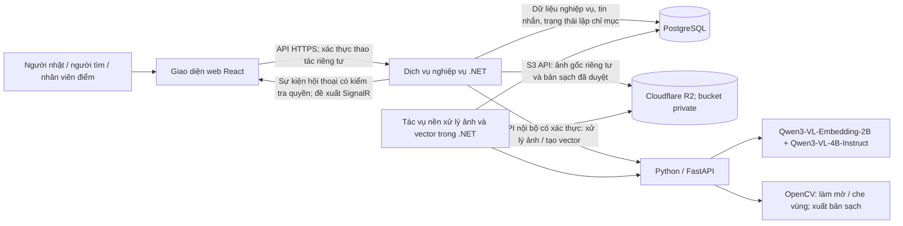
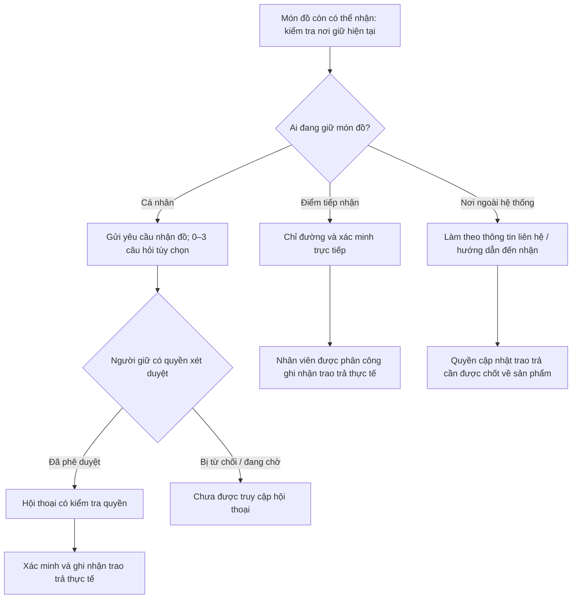

# Kiến trúc hệ thống Findie

**Phiên bản:** 1.1.1 · **Ngày:** 2026-10-22 · **Trạng thái:** Thiết kế MVP; bổ sung R2, Qwen, OpenCV và thiết kế cơ sở dữ liệu; chưa triển khai

Kiến trúc MVP trong tài liệu này chưa được triển khai; sản phẩm vẫn là bản demo ý tưởng.
[Hiến chương dự án](../.specify/memory/constitution.md) xác định các nguyên tắc bắt buộc;
[đặc tả sản phẩm](DAC_TA_FINDIE.md) cung cấp phạm vi,
BR01–BR06 và các tình huống nghiệm thu. Đặc tả phân biệt hành vi đã thể hiện trong demo
với những biện pháp bảo đảm được đề xuất cho MVP; tài liệu này giữ nguyên sự phân biệt đó.

## 1. Phạm vi thiết kế và trạng thái quyết định

MVP hỗ trợ đăng tin, tìm bằng mô tả tiếng Việt hoặc ảnh, ba nhánh nhận lại đồ, yêu cầu nhận đồ,
hội thoại sau phê duyệt, tiếp nhận tại điểm và ghi nhận trao trả. Thanh toán, vận chuyển, thu thập
nội dung từ mạng xã hội, thông báo đẩy, điểm tự đăng ký và trang quản trị đầy đủ nằm ngoài phạm vi.

- **Công nghệ đã chọn:** React, .NET, Python với FastAPI, PostgreSQL và Cloudflare R2 lưu ảnh theo yêu cầu ngày 21/10/2026. Dùng Qwen và OpenCV để xử lý ảnh; bản Instruct đã chọn là `Qwen/Qwen3-VL-4B-Instruct` theo yêu cầu ngày 22/10/2026. Mô hình embedding và các gói bổ trợ bên dưới là phương án triển khai đề xuất.
- **Phương án cơ sở được đề xuất:** thiết kế và công nghệ bổ trợ bên dưới để kế hoạch
  triển khai xem xét áp dụng và kiểm chứng. Đây không phải những lựa chọn đã được phê duyệt trước đó.
- **Biện pháp bắt buộc:** bảo vệ dữ liệu riêng tư, kiểm tra quyền thay đổi trạng thái,
  phản ánh nơi giữ thực tế, lưu bền vững dữ liệu nghiệp vụ và xử lý lỗi AI trung thực theo hiến chương.
- **Quyết định còn mở:** chính sách sản phẩm, phiên bản bất biến của mô hình/gói, nhà cung cấp đăng nhập/hạ tầng chạy và mục tiêu chất lượng ở mục 11. Nhà cung cấp lưu ảnh đã chốt là R2.

## 2. Công nghệ và trách nhiệm của các thành phần

Bảng này liệt kê bộ công nghệ dự kiến dùng cho MVP. “Đề xuất” là lựa chọn cụ thể để triển khai và kiểm chứng, chưa phải gói đã cài hay cấu hình đã hoạt động.

| Thành phần | Công nghệ | Trách nhiệm và trạng thái |
| --- | --- | --- |
| Giao diện | React, TypeScript, Vite, HTML/CSS | React đã chọn; phần bổ trợ đề xuất cho web responsive, biểu mẫu có nhãn và dùng bàn phím |
| Giao tiếp trình duyệt | Fetch API, HTTPS/JSON, `@microsoft/signalr` | Gọi API .NET và nhận sự kiện chat; không đưa khóa dịch vụ vào trình duyệt |
| Backend nghiệp vụ | C#, .NET, ASP.NET Core Web API | .NET đã chọn; API, phân quyền, kiểm tra dữ liệu, bài đăng, yêu cầu, tiếp nhận và trao trả |
| Đăng nhập và phiên | ASP.NET Core OpenID Connect + Cookie Authentication | Đề xuất dùng nhà cung cấp OIDC; cookie HttpOnly/Secure, CSRF; lưu cặp issuer/subject, không tự lưu mật khẩu; nhà cung cấp còn chờ chọn |
| Truy cập dữ liệu | Entity Framework Core, Npgsql, migrations | Đề xuất dùng giao dịch PostgreSQL và kiểm soát cập nhật đồng thời |
| Cơ sở dữ liệu | PostgreSQL, SQL | PostgreSQL đã chọn; dữ liệu nghiệp vụ, tin nhắn, tác vụ, tham chiếu ảnh; thời điểm sự kiện dùng `timestamptz` |
| Tìm kiếm vector | pgvector, Pgvector.EntityFrameworkCore | Đề xuất `vector(2048)`, khoảng cách cosine, tìm chính xác sau bộ lọc; chưa thêm chỉ mục xấp xỉ |
| Dịch vụ xử lý AI | Python, FastAPI, Uvicorn, Pydantic, python-multipart | FastAPI đã chọn; API nội bộ nhận dữ liệu đã kiểm tra, trả vector hoặc bản ảnh đã xử lý; Pydantic kiểm tra hợp đồng trả về |
| Thực thi mô hình | PyTorch, Hugging Face Transformers, Accelerate, qwen-vl-utils | Đề xuất chạy trọng số Qwen trên máy chủ; dùng mã inference chính thức đã rà soát và ghim revision |
| Embedding văn bản và ảnh | `Qwen/Qwen3-VL-Embedding-2B` | Đề xuất một mô hình chung, đầu ra 2048 chiều cho hai chế độ tìm kiếm [Q1] |
| Gợi ý vùng nhạy cảm | `Qwen/Qwen3-VL-4B-Instruct` | Chọn bản Instruct 4B theo yêu cầu ngày 22/10/2026; dùng OCR/định vị để trả vùng nghi nhạy cảm, không tự kết luận ảnh đã an toàn [Q2] |
| Làm mờ và che ảnh | OpenCV (`opencv-python-headless`), NumPy, Pillow | OpenCV được yêu cầu để làm mờ vùng bằng `GaussianBlur`; che kín vùng chữ/mã nhạy cảm khi cần; Pillow chuẩn hóa hướng ảnh, giải mã và xuất bản sạch [O1] |
| Lưu ảnh | Cloudflare R2, S3 API, `AWSSDK.S3` | R2 đã chọn; .NET tải/lấy/xóa đối tượng bằng SDK; ảnh gốc và bản sạch đều ở bucket riêng tư [R1] |
| Tác vụ nền | ASP.NET Core `BackgroundService`, `HttpClient`, PostgreSQL | Đề xuất xử lý ảnh, tạo vector và xóa tệp có retry/lease bền vững, cùng tiến trình .NET |
| Chat | ASP.NET Core SignalR | Đề xuất kiểm tra quyền, lưu PostgreSQL trước khi phát sự kiện |
| Chỉ đường | Liên kết bản đồ thông thường | Đề xuất mở địa chỉ điểm tiếp nhận; chưa cần Maps SDK hoặc dịch vụ định tuyến |
| Đóng gói và vận hành | Git, Docker, Docker Compose, HTTPS của hạ tầng triển khai | Đề xuất môi trường tái lập, mạng nội bộ, volume DB; logging/health checks sẵn có của ASP.NET Core/FastAPI; chọn máy chạy và GPU sau đo |
| Kiểm thử | xUnit + ASP.NET Core integration testing, pytest, Playwright | Đề xuất kiểm thử phân quyền/giao dịch, xử lý ảnh/mô hình và hành trình web; PostgreSQL thật với pgvector trong kiểm thử tích hợp |
| Thiết kế dữ liệu | SQL và diagrams.net (draw.io) | Lược đồ DDL và ERD chỉnh sửa được, xem mục 3 |

Mã mô hình đã có trên kho chính thức; cả hai model card ghi giấy phép Apache-2.0 [Q1, Q2]. Phải ghim commit của trọng số, mã inference, processor, prompt và phiên bản gói tương thích trước chạy thật. Chưa đo chất lượng tiếng Việt, độ bao phủ vùng nhạy cảm, độ trễ hoặc VRAM trên dữ liệu Findie. Hai mô hình dùng chung dịch vụ FastAPI, không tự phát sinh hai dịch vụ độc lập. Chưa cần Redis, Kafka, Elasticsearch, vector database riêng, reranker hoặc dịch vụ model serving bổ sung.



Chỉ .NET quản lý dữ liệu và chính sách nghiệp vụ. FastAPI không có điểm truy cập công khai
cho trình duyệt, thông tin đăng nhập cơ sở dữ liệu nghiệp vụ hoặc quyền duyệt yêu cầu,
mở hội thoại hay ghi nhận bàn giao. React chỉ nhận các trường mà người xem hiện tại được phép truy cập.
Thông tin bí mật được giữ ở phía máy chủ. FastAPI chỉ nhận ảnh gốc riêng tư để xử lý che/mờ trong phạm vi nội bộ được cấp quyền; không lưu lâu, không ghi log nội dung và không đưa ảnh gốc vào embedding công khai. .NET chuyển bytes đã kiểm tra cho FastAPI; dịch vụ AI không có credential R2 hoặc tự tải URL tùy ý.

### 2.1. Lưu trữ ảnh trên Cloudflare R2

- Dùng một bucket private mỗi môi trường, với khóa ngẫu nhiên do máy chủ tạo dưới các prefix `original/`, `sanitized/`, `temporary/`. Prefix giúp quản lý vòng đời; chính quyền bucket và kiểm tra ở API mới bảo vệ dữ liệu. Tắt public `r2.dev` và custom domain công khai.
- MVP tải ảnh qua .NET; `AWSSDK.S3` dùng endpoint tài khoản R2, region `auto`, credential giới hạn theo bucket và thao tác cần thiết. Credential chỉ ở máy chủ; không lưu signed URL vào DB [R1].
- PostgreSQL lưu bucket, object key, MIME đã kiểm tra, kích thước byte/pixel, SHA-256, phiên bản nguồn, trạng thái xử lý và người/thời điểm duyệt. Nội dung ảnh ở R2, không dùng BLOB trong DB. Tách tham chiếu ảnh gốc và bản sạch.
- API ảnh công khai chỉ đọc bản sạch đã duyệt của bài còn được phép hiển thị; ảnh gốc chỉ người đăng hoặc người xử lý được ủy quyền có thể xem qua endpoint riêng được kiểm tra quyền, `Cache-Control: no-store`. Không trả khóa/URL ảnh gốc trong DTO công khai. Với MVP, phục vụ ảnh qua .NET để kiểm tra lại quyền và trạng thái mỗi lần lấy.
- Nếu sau này dùng presigned GET để giảm tải, chỉ cấp cho bản sạch sau kiểm tra quyền, thời hạn ngắn; ai có URL đều có thể dùng đến khi hết hạn nên không dùng cách này cho ảnh gốc. Presigned URL không thay cho phân quyền [R2].
- R2 và PostgreSQL không chung một giao dịch: trước upload, ghi bản đăng ký key/chủ sở hữu/trạng thái vào `stored_objects`; upload bytes đã kiểm tra ngoài giao dịch, rồi hoàn tất metadata, liên kết ảnh và tác vụ trong giao dịch ngắn. Bản đăng ký chưa hoàn tất hoặc chưa liên kết được tác vụ dọn rác xử lý sau khoảng chờ. Xóa/gỡ bài phải thu hồi quyền hiển thị và vector trước, ghi yêu cầu xóa bền vững rồi retry xóa object. Không xóa ảnh chỉ vì một thao tác DB tạm thời lỗi.
- Ảnh tìm kiếm là dữ liệu truy vấn tạm: ưu tiên xử lý trong bộ nhớ; nếu phải ghi tạm thì chỉ prefix `temporary/`, xóa sau xử lý cả khi lỗi và có lifecycle làm lớp dọn dự phòng. Thời hạn lưu ảnh gốc và bản sạch phải được chốt trước dùng dữ liệu thật.

### 2.2. Qwen gợi ý vùng, OpenCV tạo bản ảnh an toàn

`Qwen3-VL-4B-Instruct` chỉ gợi ý bounding box của khuôn mặt, số giấy tờ/thẻ, số điện thoại, địa chỉ hoặc mã QR/barcode có thể tiết lộ thông tin. .NET/FastAPI phải kiểm tra JSON, nhãn, tọa độ hữu hạn và quy đổi đúng theo kích thước/hướng ảnh đã chuẩn hóa; không coi văn bản model trả về là lệnh.

OpenCV làm mờ vùng đã xác định bằng `GaussianBlur`; với chữ, số định danh và mã có thể đọc lại sau làm mờ, che kín vùng tương ứng. Không tuyên bố blur bảo đảm ẩn danh. Xuất lại ảnh từ pixel đã xử lý, loại bỏ EXIF/GPS và metadata không cần thiết, rồi lưu thành object mới. Người có quyền duyệt ảnh kiểm tra bản xem trước, bổ sung vùng còn sót và duyệt đúng phiên bản ảnh; người duyệt không thể bỏ qua bước xử lý bằng cách đánh dấu ảnh gốc là bản sạch. Chính sách cấp quyền, gồm việc người đăng có được tự duyệt hay không, phải chốt trước triển khai.

Các trạng thái xử lý ảnh gồm chờ, đang xử lý, chờ duyệt, đã duyệt, lỗi hoặc bị từ chối. Chỉ bản sạch **đã duyệt và còn khớp phiên bản nguồn** được hiển thị và tạo vector ảnh. Nếu AI lỗi, JSON sai, vùng không chắc chắn hoặc chưa duyệt, giữ ảnh gốc riêng tư và hiển thị placeholder; tuyệt đối không dùng ảnh gốc thay thế. Bài đăng và mô tả công khai hợp lệ vẫn được lưu và có thể tìm bằng văn bản/lọc cơ bản. Việc model trả “không có vùng nhạy cảm” vẫn cần người kiểm tra.

## 3. Dữ liệu logic và phạm vi hiển thị

| Bản ghi | Trách nhiệm và quan hệ |
| --- | --- |
| Tài khoản và phân công tại điểm | Danh tính và quyền tại điểm tiếp nhận do máy chủ quản lý |
| Món đồ và ảnh | Mô tả công khai, nơi/thời điểm nhặt, nơi giữ hiện tại, vòng đời; tham chiếu R2 gốc/bản sạch, phiên bản và trạng thái duyệt riêng |
| Điểm tiếp nhận | Tên, địa chỉ công khai, hướng dẫn đường đi và nhân viên được phân công |
| Câu hỏi xác minh | Từ không đến ba câu hỏi gắn với một món đồ |
| Yêu cầu nhận đồ và câu trả lời | Người yêu cầu, món đồ, trạng thái xét duyệt, bằng chứng riêng tư và quyết định của người duyệt |
| Hội thoại và tin nhắn | Một hội thoại cho mỗi yêu cầu được duyệt; danh tính người tham gia và tin nhắn được lưu bền vững |
| Yêu cầu tiếp nhận | Người/nơi đang giữ, điểm đích và kết quả chờ tiếp nhận/đã tiếp nhận/bị từ chối |
| Lịch sử nơi giữ/trao trả | Người thực hiện, thời điểm và việc thay đổi nơi giữ thực tế hoặc hoàn tất trao trả |
| Tác vụ xử lý và vector | Công việc che/mờ, embedding, xóa ảnh có retry; vector 2048 chiều, revision mô hình, cấu hình xử lý và phiên bản nguồn |

Thiết kế vật lý nằm trong [thiết kế cơ sở dữ liệu](database-design.md), [DDL PostgreSQL](database-schema.sql) và [ERD draw.io](findie-erd.drawio). Đây là bản thiết kế cho ứng dụng mới; chưa có migration được áp dụng lên dữ liệu thật. DDL là nguồn đối chiếu tên bảng, khóa và ràng buộc; ERD trình bày quan hệ để rà soát.

Trạng thái yêu cầu nhận đồ, trạng thái tiếp nhận, vòng đời món đồ và loại nơi giữ phải tách biệt:
phê duyệt không có nghĩa đã trao trả; gửi yêu cầu tiếp nhận không có nghĩa điểm đã giữ món đồ.
Mỗi món đồ có một nơi giữ hiện tại và tối đa một lần trao trả hoàn tất.

Dữ liệu công khai chỉ gồm ảnh món đồ đủ điều kiện công khai, mô tả công khai, khu vực/thời điểm
nhặt, trạng thái có thể nhận lại và hướng dẫn nhận phù hợp. Địa chỉ công khai của điểm tiếp nhận
hoặc nơi ngoài hệ thống được phân biệt với địa chỉ nhà riêng của người giữ.
Câu trả lời xác minh, địa chỉ nhà riêng, tin nhắn và thông tin xác thực là dữ liệu riêng tư.
Chỉ người yêu cầu và người có quyền xét duyệt được xem câu trả lời; không đưa câu trả lời vào
vector tìm kiếm công khai. Nhật ký không ghi bí mật, toàn bộ câu trả lời xác minh hoặc nội dung tin nhắn.

Tách nơi nhặt khỏi nơi giữ; giữ nguyên tính ước lượng hoặc không xác định của thời điểm nhặt.
Lưu thời gian sự kiện theo UTC và hiển thị theo Asia/Ho_Chi_Minh; giữ đúng ý nghĩa ngày/khoảng giờ địa phương.

## 4. Đăng đồ nhặt được và lập chỉ mục bền vững

1. React hiển thị ảnh xem trước và thu thập mô tả công khai, nơi/thời điểm nhặt,
   lựa chọn nơi giữ và câu hỏi xác minh tùy chọn.
2. .NET kiểm tra quyền người đăng, các trường dữ liệu và nội dung thực tế của tệp.
   Các định dạng JPEG/PNG/WebP và giới hạn 10 MB là đề xuất cần xác nhận về sản phẩm;
   áp dụng các giới hạn được chốt, kể cả kích thước ảnh sau giải mã, trước khi công khai ảnh.
3. Đăng ký khóa R2 do máy chủ tạo, chủ sở hữu và trạng thái trong `stored_objects` trước upload. Lưu bytes đã kiểm tra lên R2 ngoài giao dịch DB. Trong giao dịch ngắn tiếp theo, hoàn tất metadata object, lưu món đồ/liên kết ảnh/phiên bản nguồn và công việc xử lý ảnh/tạo vector văn bản bền vững. Ảnh gốc vẫn riêng tư chờ xử lý.
   Nếu bước hoàn tất thất bại, bản đăng ký bền vững cho phép thử lại hoặc dọn object sau khoảng chờ; không công khai upload chưa hoàn tất.
4. Báo đăng tin thành công khi dữ liệu nghiệp vụ đã được lưu bền vững. Hiển thị đúng trạng thái
   lập chỉ mục và xử lý ảnh đang chờ/thất bại. Ảnh chờ duyệt dùng placeholder; mô tả công khai vẫn có thể được liệt kê và tạo vector riêng.
5. Tác vụ nền chạy trong cùng tiến trình .NET, triển khai bằng
   [dịch vụ nền do ASP.NET Core quản lý](https://learn.microsoft.com/en-us/aspnet/core/fundamentals/host/hosted-services),
   lấy công việc xử lý ảnh/lập chỉ mục đến hạn từ PostgreSQL,
   nhận xử lý công việc với thời hạn giữ quyền và gọi FastAPI ngoài giao dịch cơ sở dữ liệu.
6. Với ảnh: chạy quy trình che/mờ và duyệt ở mục 2.2 trước khi tạo vector ảnh. Với vector: kiểm tra định danh và revision mô hình, cấu hình prompt/tiền xử lý, loại dữ liệu, 2048 chiều và giá trị hữu hạn khác vector không.
   Chỉ lưu vector nếu phiên bản nội dung nguồn vẫn khớp và ảnh nguồn là bản sạch được duyệt hiện tại.
   Cập nhật vector và trạng thái tác vụ nguyên tử; kết quả cũ không được ghi đè nội dung mới.
7. Khi hết thời gian chờ hoặc gặp lỗi tạm thời, lưu số lần thử và thời điểm thử lại tiếp theo,
   với số lần thử bị giới hạn. Khi hết giới hạn cấu hình, giữ trạng thái lỗi có thể thấy được
   và cho phép thử lại có kiểm soát. Sau khởi động lại, tác vụ nền lấy lại công việc đang chờ
   hoặc đã hết thời hạn giữ quyền từ PostgreSQL.

Sửa nội dung dùng để tìm kiếm phải tăng phiên bản, vô hiệu hóa vector bị ảnh hưởng và tạo
công việc mới trong cùng giao dịch nghiệp vụ. Thay ảnh gốc, vùng che hoặc bản sạch cũng phải tăng phiên bản ảnh, hủy hiệu lực duyệt/vector cũ trước khi xử lý lại. Các lần thử lại dùng định danh thao tác ổn định
để gửi lặp không tạo bài đăng hoặc thao tác đã hoàn tất trùng nhau. Giới hạn thử lại và khoảng
chờ tăng dần thuộc cấu hình triển khai; tài liệu không tự đặt cam kết mức dịch vụ.

```mermaid
sequenceDiagram
    participant Web as React
    participant API as API .NET
    participant DB as PostgreSQL
    participant Work as Tác vụ nền .NET
    participant AI as FastAPI
    Web->>API: Gửi món đồ và tham chiếu tệp tải lên đã kiểm tra
    API->>DB: Hoàn tất giao dịch lưu món đồ, phiên bản và tác vụ chờ lập chỉ mục
    API-->>Web: Đã lưu bài đăng; đang chờ lập chỉ mục
    Work->>DB: Nhận công việc đến hạn và đọc phiên bản nguồn
    Note over Work,AI: Với ảnh: xử lý Qwen/OpenCV và duyệt bản sạch trước bước embedding
    Work->>AI: Tạo vector văn bản công khai hoặc ảnh sạch đã duyệt
    AI-->>Work: Vector và thông tin mô hình, hoặc lỗi
    alt Phản hồi hợp lệ và phiên bản vẫn là hiện tại
        Work->>DB: Lưu vector và đánh dấu sẵn sàng một cách nguyên tử
    else Lỗi hoặc nguồn đã cũ
        Work->>DB: Lưu trạng thái thử lại/lỗi hoặc loại kết quả cũ
    end
```

## 5. Tìm kiếm và chi tiết món đồ

Yêu cầu mô tả tiếng Việt không rỗng hoặc ảnh hợp lệ. Tìm chỉ bằng mô tả là quy tắc cốt lõi.
Khi người dùng cung cấp cả hai, giao diện ban đầu được đề xuất cho chọn tìm theo mô tả hoặc
ảnh; việc kết hợp điểm vẫn cần quyết định sản phẩm và đánh giá.

.NET kiểm tra truy vấn và bộ lọc, lấy vector truy vấn từ FastAPI, sau đó tìm các món đồ
đủ điều kiện trong PostgreSQL bằng loại dữ liệu, mô hình và số chiều tương ứng.
Dùng `Qwen3-VL-Embedding-2B` cho cả hai nhánh, chuẩn hóa L2 và lưu `vector(2048)`. MVP giữ hành vi văn bản–văn bản và ảnh–ảnh; khả năng chung không gian của mô hình không tự động bật trộn điểm hoặc tìm chéo phương thức khi chưa đánh giá. Lọc cùng tên/revision mô hình, profile prompt/tiền xử lý, số chiều và phiên bản nguồn hợp lệ; không trộn vector khác profile hoặc mô hình khác dù cùng số chiều.

Bắt đầu bằng cosine exact search (`<=>`) sau lọc trong pgvector. `vector(2048)` dùng được cho lưu trữ/tìm chính xác, nhưng HNSW/IVFFlat trên kiểu `vector` hiện giới hạn 2000 chiều. Nếu cần tăng tốc, đánh giá chỉ mục biểu thức `halfvec(2048)` hoặc số chiều MRL thấp hơn trước khi đổi schema và lập chỉ mục lại; không tạo HNSW `vector(2048)` trong baseline. Xem [tài liệu pgvector](https://github.com/pgvector/pgvector#indexing).

Coi ảnh và mô tả tìm kiếm là đầu vào truy vấn tạm thời, không phải bài đăng công khai mới.
Xóa tệp truy vấn tạm sau xử lý và đặt thời hạn hết hiệu lực cho tệp tải lên bị bỏ dở.
Muốn lưu lịch sử tìm kiếm phải có chính sách thời hạn lưu rõ ràng. FastAPI nhận nội dung
đã được .NET kiểm tra, không tự tải từ URL tùy ý do người dùng cung cấp.

Khu vực và thời điểm mất ước lượng dùng để giới hạn hoặc hỗ trợ xếp hạng kết quả.
Chốt độ rộng bộ lọc khi lập kế hoạch sản phẩm; thông báo rõ khi nới điều kiện lọc.
Không âm thầm loại toàn bộ ứng viên chỉ vì thời gian ước lượng không khớp tuyệt đối.
Kiểm tra lại quyền hiển thị và trạng thái có thể nhận khi trả kết quả hoặc mở chi tiết.

Nếu suy luận mô hình lỗi, thông báo và cho phép xem danh sách/lọc cơ bản. Khi không có
kết quả, cho sửa điều kiện tìm; không tạo món đồ tương tự giả.
Độ tương đồng không phải bằng chứng sở hữu hay xác suất đã hiệu chỉnh. Cần đo chất lượng
với từ đồng nghĩa tiếng Việt, ảnh khác góc chụp và các món đồ có vẻ ngoài giống nhau.

## 6. Yêu cầu nhận đồ, hội thoại và ba nhánh nhận lại đồ



Không có câu hỏi vẫn phải gửi được yêu cầu nhận đồ. Việc bắt buộc trả lời mọi câu hỏi
đã thiết lập còn chưa chốt. Backend kiểm tra quyền gửi và xét duyệt yêu cầu theo trạng thái
món đồ và người giữ hiện tại; không tin vai trò hay giá trị phê duyệt do phía giao diện gửi lên.

Với yêu cầu đã được duyệt, .NET chỉ cho người tham gia có quyền kết nối, đọc lịch sử
hoặc gửi tin. Kiểm tra từng thao tác, kể cả kết nối lại và đăng ký nhận sự kiện nhóm.
Thiết kế SignalR được đề xuất lưu từng tin nhắn được chấp nhận trước khi xác nhận
và phát thông báo. Mã tin nhắn do phía giao diện tạo phải duy nhất trong phạm vi người gửi
và hội thoại tại PostgreSQL; gửi lại trả về tin đã lưu, không tạo thêm tin khác.
Cùng mã đó giúp giao diện loại bỏ sự kiện thời gian thực bị lặp.
Khi kết nối lại, kiểm tra lại quyền và lấy tin đã lưu từ sau vị trí cuối cùng đã biết;
sự kiện thời gian thực có thể chậm hoặc bị lỡ, nên không phải nguồn dữ liệu chuẩn.

Phê duyệt cấp quyền trao đổi, không chứng minh sở hữu hoặc xác nhận đã trao trả.
Cần quyết định việc duyệt nhiều người cùng lúc, thu hồi, rút yêu cầu, quyền hội thoại sau trao trả
và thời hạn lưu hội thoại trước khi triển khai các chuyển đổi vòng đời tương ứng.
Đổi nơi giữ không được âm thầm chuyển quyền truy cập dữ liệu riêng tư sang người khác.
Nơi ngoài hệ thống không mặc định có tài khoản hoặc được ủy quyền xét duyệt.

## 7. Giao dịch tiếp nhận, thay đổi nơi giữ và trao trả

Yêu cầu tiếp nhận bắt đầu ở trạng thái chờ, nơi giữ không đổi. Việc điểm đồng ý về thủ tục
khác với việc đã nhận món đồ thực tế.
Chỉ nhân viên có quyền và được phân công tại điểm đích mới được xác nhận đã nhận thực tế.
Trong một giao dịch, kiểm tra lại nơi giữ và phiên bản món đồ, xác nhận tiếp nhận,
đổi nơi giữ và bổ sung lịch sử. Từ chối phải giữ nguyên nơi giữ hiện tại.

Khi trao trả, người giữ hiện tại có quyền hoặc nhân viên được phân công tại điểm xác minh
người yêu cầu và ghi nhận bàn giao thực tế. Thay đổi trạng thái có thể nhận và bổ sung
lịch sử người thực hiện/thời điểm một cách nguyên tử. Dùng kiểm tra phiên bản, cập nhật
có điều kiện hoặc khóa bản ghi để hai lần trả đồng thời, hoặc tiếp nhận và trả cùng lúc,
không tạo hai nơi giữ hay hai lần trả hoàn tất. Thử lại phải trả về kết quả đã có,
không lặp tác động nghiệp vụ. Không đánh dấu đã trả chỉ vì yêu cầu được duyệt,
hội thoại được mở hoặc người dùng xem đường đi.

Quyền và bằng chứng cần có để cập nhật trao trả tại nơi ngoài hệ thống vẫn chưa chốt.
Kế hoạch cuối cùng cũng phải giải quyết yêu cầu nhận đồ/tiếp nhận đang chờ bị xung đột
khi nơi giữ hoặc trạng thái có thể nhận thay đổi; không tự đặt quy tắc tự duyệt hay tự hủy.

## 8. Bảo mật, xử lý lỗi và trải nghiệm người dùng

- Kiểm tra quyền mọi thao tác ghi và đọc dữ liệu riêng tư tại .NET; từ chối truy cập ngoài
  phạm vi món đồ, yêu cầu, hội thoại hoặc điểm được phân công của người gọi.
- Ưu tiên hệ thống xác thực đã được sử dụng rộng rãi với phiên an toàn. Chốt quyền đọc
  khi chưa đăng nhập, cách đăng nhập, cách truyền thông tin phiên và cấp quyền nhân viên
  trước triển khai; chống CSRF cho thao tác ghi xác thực bằng cookie và giới hạn nguồn truy cập.
  Kiểm tra riêng nguồn kết nối WebSocket vì CORS không bảo vệ phương thức truyền này.
  Xem [hướng dẫn bảo mật SignalR](https://learn.microsoft.com/en-us/aspnet/core/signalr/security).
- Giữ FastAPI và PostgreSQL trong mạng riêng; xác thực lời gọi giữa các dịch vụ, giới hạn
  dung lượng yêu cầu, đặt thời gian chờ và giới hạn tần suất đăng tin, yêu cầu, tìm kiếm, hội thoại phù hợp.
- Kiểm tra nội dung, dung lượng và kích thước ảnh sau giải mã; luôn tách ảnh gốc riêng tư và bản sạch được duyệt. Áp dụng quy trình mục 2.2 cả khi model không phát hiện vùng nhạy cảm. Không để lộ khóa lưu trữ gốc hoặc metadata GPS.
- Giữ dữ liệu biểu mẫu khi lỗi; phân biệt lỗi dữ liệu, quyền, xung đột và dịch vụ.
  Không báo thành công trước khi ghi bền vững. Giao diện trên điện thoại và dùng bàn phím
  phải có nhãn, dấu hiệu tiêu điểm rõ và lỗi dễ đọc, không chỉ dựa vào màu sắc.

## 9. Triển khai tối thiểu và vận hành

Triển khai một giao diện React, một bản chạy .NET gồm tác vụ nền lập chỉ mục, một dịch vụ
FastAPI nội bộ, một cơ sở dữ liệu PostgreSQL và Cloudflare R2.
Phương án pgvector được đề xuất yêu cầu hệ cơ sở dữ liệu được chọn hỗ trợ cài phần mở rộng này.
Dùng HTTPS tại điểm truy cập công khai; ưu tiên giao diện và API cùng trang web để đơn giản hóa
quản lý phiên OIDC/cookie. R2 đã chốt; chọn hạ tầng chạy, nhà cung cấp OIDC và quy mô tài nguyên sau. Docker Compose phục vụ môi trường phát triển/demo, chưa phải cam kết cấu hình production.

Nạp mô hình đã cố định phiên bản trong FastAPI; tách kiểm tra sẵn sàng khỏi kiểm tra tiến trình còn chạy.
Với Instruct 4B, đo VRAM/RAM, độ trễ và mức dùng bộ nhớ khi nạp cùng mô hình embedding trên máy chạy thực tế; chưa chốt cấu hình GPU hoặc mức bộ nhớ tối thiểu.
Bắt đầu với một tiến trình phục vụ mô hình và đo bộ nhớ trước khi thêm tiến trình xử lý;
bộ nhớ mô hình thường được nhân bản giữa các tiến trình.
Xem [các khái niệm triển khai FastAPI](https://fastapi.tiangolo.com/deployment/concepts/#memory-per-process).
Lưu tiến độ lập chỉ mục để giữ được qua khởi động lại. Ghi mã liên kết yêu cầu, kết quả
thao tác, thay đổi trạng thái và ngữ cảnh lỗi an toàn; không ghi nội dung riêng tư vào nhật ký.
Theo dõi tồn đọng/lỗi lập chỉ mục và độ trễ tìm kiếm/hội thoại trước khi đặt mục tiêu dịch vụ.
Sao lưu nhất quán dữ liệu và ảnh được tham chiếu; thực hiện khôi phục thành công trước
thử nghiệm với người dùng thật. Quy tắc lưu/xóa dữ liệu phải bao gồm cả bản sao lưu và vector.
Nhiều bản chạy .NET cần cơ chế dùng chung để phân phối sự kiện hội thoại và phối hợp tác vụ nền
an toàn; việc mở rộng này nằm ngoài phương án ban đầu dùng một bản chạy.

## 10. Kiểm chứng trước khi thử nghiệm thực tế

Kiểm chứng BR01–BR06 và các tình huống AC01–AC24 liên quan trong đặc tả sản phẩm.
Bao gồm truy cập trực tiếp API/hội thoại trái quyền, gửi lặp, trả/tiếp nhận đồng thời,
khởi động lại tác vụ nền, hết thời gian suy luận, vector cũ, kết nối lại hội thoại và tải ảnh lỗi.
Đo khả năng tìm bằng tiếng Việt trên truy vấn có nhãn và ảnh khác góc, gồm các món giống nhau;
báo cáo chất lượng tìm đúng trong nhóm kết quả đầu và độ trễ trên dữ liệu/phần cứng thực tế.
Kiểm tra riêng ảnh có giấy tờ, thẻ, khuôn mặt và QR ở góc nghiêng/nhỏ: model bỏ sót, trả tọa độ sai, OpenCV lỗi, thay ảnh sau duyệt và worker trả kết quả cũ đều không làm lộ bản gốc. Kiểm tra EXIF/GPS đã loại, không truy cập được object gốc ngoài API có quyền, dọn tệp truy vấn khi lỗi và không tạo image embedding từ ảnh chưa duyệt. Đo recall vùng nhạy cảm và mức còn đọc được sau che/mờ bằng dữ liệu có nhãn; duyệt người dùng không thay cho kiểm thử chất lượng.
Ghi kết quả kiểm tra điện thoại/bàn phím và một lần khôi phục sao lưu thành công.
Đặt mục tiêu định lượng sau khi đo; bản dự thảo không cam kết SLA hoặc điểm chất lượng mô hình.

## 11. Các quyết định cần chốt trước phần triển khai liên quan

| Nhóm | Người phụ trách quyết định cần chốt |
| --- | --- |
| Định danh | Nhà cung cấp OIDC cho baseline cookie đề xuất, quyền đọc khi chưa đăng nhập và cấp quyền nhân viên |
| Xác minh | Ai tạo câu hỏi, câu trả lời bắt buộc, bằng chứng tại điểm và xử lý tranh chấp |
| Vòng đời yêu cầu nhận đồ | Duyệt đồng thời, rút/thu hồi, tác động khi đổi nơi giữ và hội thoại sau trao trả |
| Nơi giữ | Quy trình điểm đồng ý trước và quyền cập nhật trao trả tại nơi ngoài hệ thống |
| Vòng đời dữ liệu | Thời hạn lưu ảnh gốc/bản sạch/tệp tạm, sửa/gỡ, người được quyền duyệt ảnh và chính sách xóa bản sao lưu |
| Tìm kiếm và xử lý ảnh | Độ rộng bộ lọc, dữ liệu đánh giá tiếng Việt/vùng nhạy cảm, mục tiêu chất lượng; xác nhận hai mã Qwen đề xuất sau benchmark và ghim revision/profile |
| Triển khai | Phiên bản môi trường/gói, tài khoản/bucket R2 và retention, hạ tầng CPU/GPU, giới hạn upload/retry và ngân sách vận hành |

Chốt các quyết định trong kế hoạch tính năng; cập nhật tài liệu khi thành phần hoặc ranh giới tin cậy thay đổi.


## 12. Nguồn kỹ thuật

- **Q1:** [Model card Qwen3-VL-Embedding-2B](https://huggingface.co/Qwen/Qwen3-VL-Embedding-2B): text/image, không gian chung, 2048 chiều, giấy phép và hướng dẫn inference.
- **Q2:** [Model card Qwen3-VL-4B-Instruct](https://huggingface.co/Qwen/Qwen3-VL-4B-Instruct): OCR, định vị vùng và giấy phép; khả năng che dữ liệu riêng tư của Findie vẫn phải kiểm chứng.
- **O1:** [OpenCV làm mờ ảnh](https://docs.opencv.org/4.x/d4/d13/tutorial_py_filtering.html): `GaussianBlur`; đây là phép xử lý pixel, không phải mô hình phát hiện PII.
- **R1:** [Cloudflare R2 với AWS SDK for .NET](https://developers.cloudflare.com/r2/examples/aws/aws-sdk-net/) và [bucket công khai](https://developers.cloudflare.com/r2/buckets/public-buckets/).
- **R2:** [Cloudflare R2 presigned URL](https://developers.cloudflare.com/r2/api/s3/presigned-urls/) và [object lifecycle](https://developers.cloudflare.com/r2/buckets/object-lifecycles/).

Model card Qwen3-VL-4B-Instruct được đối chiếu ngày 22/10/2026; các nguồn còn lại được đối chiếu ngày 21/10/2026. Các tài liệu xác nhận khả năng của thành phần, không xác nhận Findie đã triển khai, đã đạt chất lượng hoặc có chi phí/độ trễ cụ thể.
